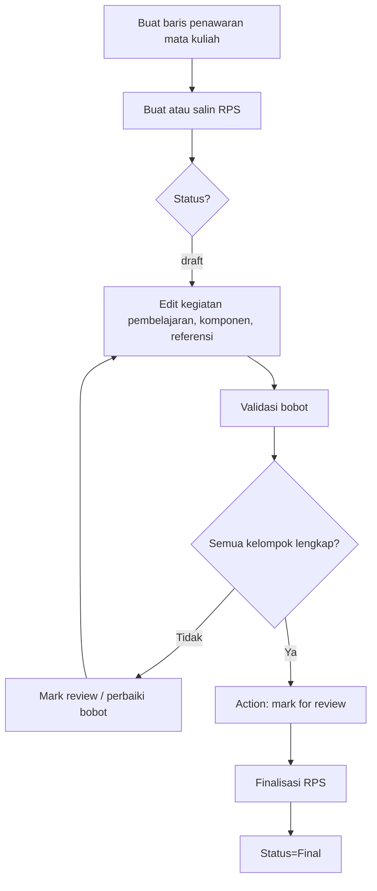
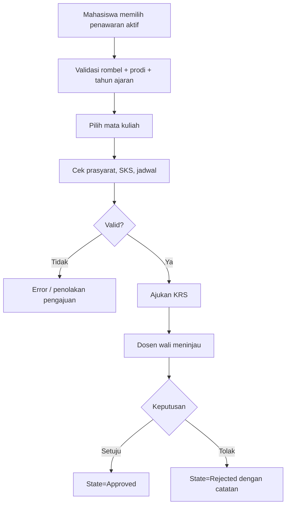
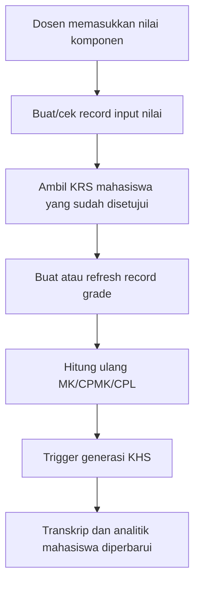
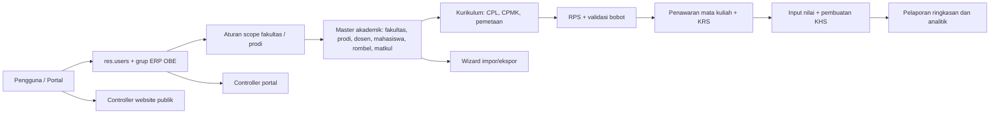

# Dokumentasi Teknis & Fungsional ERP OBE Management

## 1. Ringkasan Eksekutif

Modul `erpobe` adalah sistem manajemen akademik kustom berbasis Odoo 19 yang dirancang untuk kebutuhan Outcome-Based Education (OBE). Modul ini mencakup data master akademik, manajemen kurikulum, penawaran mata kuliah, alur KRS, penilaian, pelaporan CPL/CPMK, serta informasi akademik yang ditampilkan pada portal publik dan portal pengguna.

Implementasinya bukan sekadar wrapper dari modul standar Odoo. Modul ini menambahkan model domain yang luas untuk fakultas/program studi, mahasiswa, dosen, penawaran matakuliah, RPS, capaian pembelajaran, validasi bobot, penilaian, serta analitik akademik.

Modul ini dibangun dengan komponen utama berikut:
- model dan logika bisnis di `models/`
- wizard impor/ekspor di `wizard/`
- controller website/public di `controllers/`
- struktur UI dan menu di `views/`
- grup keamanan dan record rules di `security/`
- data demo dan migrasi di `data/` serta `migrations/`

## 2. Struktur Proyek dan Arsitektur Loading

```text
custom_module/erpobe/
├── __init__.py
├── __manifest__.py
├── README.md
├── TECHNICAL_DOCUMENTATION.md
├── controllers/
│   ├── __init__.py
│   ├── const.py
│   ├── fakultas.py
│   ├── helpers.py
│   ├── main.py
│   ├── perbandingan.py
│   ├── portal.py
│   ├── portal_base.py
│   ├── portal_dosen.py
│   ├── portal_mahasiswa.py
│   ├── profil.py
│   └── tracking.py
├── data/
│   ├── fixture_01_fakultas_prodi.xml
│   ├── fixture_02_tahun_ajaran_rombels.xml
│   ├── fixture_05_komponen_bobot.xml
│   └── fixture_12_academic_fixture.xml
├── migrations/
│   └── 19.0.2.1.0/
│       ├── README.md
│       ├── post-migration.py
│       ├── pre-migration.py
│       └── rollback.py
├── models/
│   ├── __init__.py
│   ├── akademik_cpl.py
│   ├── akademik_cpl_mk_cpmk.py
│   ├── akademik_cpmk.py
│   ├── akademik_fakultas.py
│   ├── akademik_krs.py
│   ├── akademik_komponen.py
│   ├── akademik_penawaran.py
│   ├── akademik_rps.py
│   ├── akademik_tahunajaran.py
│   ├── bobot_cpmk_mk.py
│   ├── bobot_komponen_cpmk.py
│   ├── faculty_access.py
│   ├── grade.py
│   ├── grade_cpl.py
│   ├── grade_cpmk.py
│   ├── grade_mk.py
│   ├── master_akademik.py
│   ├── master_angkatan_view.py
│   ├── master_grade.py
│   ├── master_prodi.py
│   ├── master_user.py
│   ├── report_khs.py
│   ├── report_summary.py
│   ├── res_partner.py
│   ├── rps_lock.py
│   ├── weight_monitor.py
│   ├── weight_validation.py
│   └── ...
├── scripts/
│   └── generate_demo_xml.py
├── security/
│   ├── groups.xml
│   ├── ir.model.access.csv
│   └── rules.xml
├── static/
│   └── src/
│       ├── js/print.js
│       └── scss/
├── tests/
│   ├── __init__.py
│   ├── test_faculty_scope.py
│   ├── test_import_export.py
│   ├── test_rps_versioning.py
│   ├── test_triton_workflows.py
│   ├── test_ui_views.py
│   └── test_weight_validation.py
├── views/
│   ├── akademik_cpl_views.xml
│   ├── akademik_cpmk_views.xml
│   ├── akademik_fakultas_views.xml
│   ├── akademik_komponen_views.xml
│   ├── akademik_krs_views.xml
│   ├── akademik_penawaran_views.xml
│   ├── akademik_rps_views.xml
│   ├── akademik_tahunajaran_views.xml
│   ├── grade_cpl_views.xml
│   ├── grade_cpmk_views.xml
│   ├── grade_mk_views.xml
│   ├── grade_views.xml
│   ├── import_export_views.xml
│   ├── master_akademik_views.xml
│   ├── master_angkatan_view_views.xml
│   ├── master_grade_views.xml
│   ├── master_prodi_views.xml
│   ├── master_user_views.xml
│   ├── menus.xml
│   ├── report_khs_views.xml
│   ├── report_summary_views.xml
│   ├── triton_portal_templates.xml
│   ├── triton_public_templates.xml
│   ├── triton_reports.xml
│   ├── triton_settings_views.xml
│   └── weight_monitor_views.xml
├── wizard/
│   ├── __init__.py
│   ├── import_cpl.py
│   ├── import_cpmk.py
│   ├── import_dosen.py
│   ├── import_export_mixin.py
│   ├── import_fakultas.py
│   ├── import_komponen.py
│   ├── import_mahasiswa.py
│   ├── import_matakuliah.py
│   ├── import_prodi.py
│   ├── import_rombel.py
│   ├── import_tahunajaran.py
│   ├── rps_copy.py
│   └── ...
└── ...
```

### Konteks manifest dan dependency

Manifest modul menyatakan:
- `depends`: `base`, `web`, `website`, `portal`, `contacts`, `mail`
- `external_dependencies`: `python`: `openpyxl`, `xlsxwriter`
- `application`: `True`
- `installable`: `True`

Ini adalah modul fitur penuh, bukan hanya ekstensi kecil. Modul ini memanfaatkan `mail.thread` dan `mail.activity.mixin` pada beberapa model, serta `website` dan `portal` untuk antarmuka mahasiswa dan dosen.

### Urutan loading dan konvensi penamaan

Kode mengikuti pola Odoo yang umum:
1. `__init__.py` meng-import controller, model, dan wizard.
2. `models/__init__.py` meng-import seluruh modul domain sesuai kelompok logis.
3. `security/*.xml` dan seluruh fixture akademik dimuat lewat key manifest `data`.
4. Fixture akademik dimuat setelah grup, ACL, dan record rules.
5. impor/ekspor dan route portal merupakan concern runtime yang terpisah dari model utama.

### Fixture akademik dan akun pengguna

Sebelas berkas XML fixture masih menggunakan nama lama berawalan `demo_`, tetapi
seluruhnya didaftarkan pada key manifest `data`; modul tidak mendeklarasikan key `demo`.
Karena itu, fixture dimuat pada instalasi biasa tanpa mengaktifkan demo database. XML
fixture menggunakan external ID stabil dan `noupdate` untuk menjaga data yang telah
diinstal agar upgrade tidak menimpa perubahan database.

`demo_06_akun_akses.xml` memanggil
`res.users.load_erpobe_fixture_users`. Seeder membatasi cakupan ke program studi yang
memiliki external ID fixture modul, kemudian memastikan satu Admin Prodi, tiga profil
dosen, dan dua puluh profil mahasiswa per prodi. Akun dosen/mahasiswa terkait ke profil
dan prodi yang sudah ada; mahasiswa memakai rombel prodi yang tersedia. Seeder
idempoten dan hanya membuat kekurangan. Kredensial, relasi, dan hak akses yang sudah ada
tidak ditimpa; tautan user yang memang belum ada hanya dibuat jika akun terkait tidak
memiliki relasi profil lain dan role/cakupannya cocok. Data yang konflik dihentikan dengan
validasi.

Akun yang baru dibuat seeder menggunakan password awal `Demo123!`, yang disimpan melalui
mekanisme standar Odoo. Nama login mengikuti kode prodi, misalnya `admin.if`,
`dosen.if.01`, dan `mahasiswa.if.001` untuk kode `IF`. Akun `demo_admin_erpobe` lama,
termasuk yang belum memiliki cakupan prodi, tidak diubah atau dihapus; fixture baru tidak
membuat akun global tersebut.

Instalasi baru maupun upgrade dapat dijalankan tanpa opsi demo:

```sh
./odoo-bin -c <odoo.conf> -d <database> -i erpobe --stop-after-init
./odoo-bin -c <odoo.conf> -d <database> -u erpobe --stop-after-init
```

## 3. Inventaris Fitur Fungsional

### 3.1 Manajemen fakultas dan program studi

- Nama fitur: Manajemen Fakultas / Program Studi
- Tujuan: Mengelola struktur organisasi akademik.
- Permasalahan bisnis: Memisahkan institusi, fakultas, dan program studi dengan kepemilikan akses dan cakupan akademik yang jelas.
- Menu Odoo: ERP OBE > Fakultas / Program Studi
- Model: `erpobe.master.fakultas`, `erpobe.master.prodi`
- Field kunci: `name`, `kode`, `fakultas_id`, `prodi_ids`, `dosen_ids`, `mahasiswa_ids`, `matakuliah_ids`, `rombel_ids`, `user_ids`
- Workflow: buat fakultas -> tetapkan prodi -> kelola dosen dan mahasiswa
- Validasi: kode fakultas unik, kode prodi unik per fakultas, penghapusan diblokir bila masih digunakan data terkait
- Hak akses: admin dan superadmin dapat mengelola; grup lain dibatasi oleh `erpobe_prodi_ids` dan record rules

### 3.2 Data master akademik

- Nama fitur: Dosen, Mahasiswa, Rombel, Mata Kuliah
- Tujuan: Mengelola data staf pengajar, profil mahasiswa, cohort, dan katalog mata kuliah.
- Permasalahan bisnis: Memastikan mahasiswa dan dosen terikat pada prodi dan angkatan yang benar, serta memiliki akun pengguna yang sesuai.
- Model:
  - `erpobe.master.dosen` (inherits `res.partner`)
  - `erpobe.master.mahasiswa` (inherits `res.partner`)
  - `erpobe.master.rombel`
  - `erpobe.master.matakuliah`
- Field penting: `nip`, `nim`, `rombel_id`, `prodi_id`, `fakultas_id`, `mk_prasyarat_ids`, `koordinator_id`, `tim_pengampu_ids`
- Validasi: NIP/NIM unik, wajib terdaftar pada minimal satu prodi, mahasiswa harus masuk rombel valid, mata kuliah prasyarat harus dari prodi yang sama
- Hak akses: mahasiswa hanya bisa akses data sendiri; dosen akses data sendiri dan cakupan prodi; admin mengelola secara global

### 3.3 Kurikulum dan capaian pembelajaran

- Nama fitur: CPL / CPMK / matriks pemetaan
- Tujuan: Mengelola capaian pembelajaran dan hubungan antar capaian kurikulum dan mata kuliah.
- Permasalahan bisnis: Menjaga keterkaitan Outcome-Based Education agar pengajaran dan evaluasi sesuai target capaian.
- Model:
  - `erpobe.akademik.cpl`
  - `erpobe.akademik.cpmk`
  - `erpobe.akademik.cpl.mk.cpmk`
- Perilaku utama:
  - CPL didefinisikan per program studi
  - CPMK milik suatu mata kuliah
  - tabel pemetaan menghubungkan CPMK ke CPL
  - pemetaan ini dipakai pada validasi bobot dan agregasi nilai
- Hak akses: admin dan dosen dapat mengelola; mahasiswa hanya baca atau disembunyikan tergantung ACL

### 3.4 Manajemen RPS dan versioning

- Nama fitur: Siklus hidup RPS (draft -> review -> final)
- Tujuan: Membuat, meninjau, dan memfinalisasi rencana pembelajaran semester.
- Permasalahan bisnis: Menjamin setiap mata kuliah memiliki RPS yang jelas, terdokumentasi, dan memiliki bobot yang valid.
- Model:
  - `erpobe.akademik.rps`
  - `erpobe.akademik.kegiatan.perkuliahan`
  - `erpobe.akademik.metode.pembelajaran`
  - `erpobe.akademik.referensi`
  - `erpobe.akademik.rubrik.penilaian`
  - `erpobe.akademik.kriteria`
- Struktur: RPS melekat pada baris penawaran mata kuliah dan memiliki versi, sumber salinan, dan status.
- Validasi:
  - data final tidak bisa diedit atau dihapus
  - versi baru dibuat lewat salin/duplicate
  - mata kuliah pada RPS harus sama dengan mata kuliah pada penawaran
  - finalisasi hanya diperbolehkan bila total bobot lengkap dan sesuai toleransi `100 ± 0.01`
- Field kunci: `status`, `version`, `source_rps_id`, `komponen_ids`, `cpmk_ids`, `bobot_cpmk_mk_ids`, `bobot_komponen_cpmk_ids`

### 3.5 Validasi bobot dan monitoring kelengkapan

- Nama fitur: Monitor kelengkapan bobot
- Tujuan: Memastikan alokasi bobot mencapai 100% pada tiap hubungan evaluasi.
- Permasalahan bisnis: Mencegah struktur evaluasi yang tidak lengkap atau terlalu berlebih.
- Model: `erpobe.weight.validation`, `erpobe.weight.monitor`, `erpobe.bobot.*`
- Logika utama: `ErpObeWeightValidation.get_rps_summary()` mengecek 4 hubungan:
  - `cpmk_cpl`
  - `cpl_cpmk`
  - `cpmk_mk`
  - `komponen_cpmk`
- Toleransi: selisih 0,01 masih dianggap `complete`.
- Alur: RPS -> sinkronisasi bobot -> perbandingan total -> daftar issue -> penghambat finalisasi

### 3.6 Alur penawaran dan KRS

- Nama fitur: Penawaran mata kuliah dan KRS mahasiswa
- Tujuan: Menjodohkan mahasiswa dengan kelas yang tersedia dan memungkinkan pengajuan KRS serta persetujuan dosen wali.
- Model:
  - `erpobe.akademik.tahunajaran`
  - `erpobe.akademik.penawaran` dan `erpobe.akademik.penawaran.line`
  - `erpobe.akademik.krs` dan `erpobe.akademik.krs.line`
- Workflow:
  - buat tahun ajaran aktif
  - buat penawaran untuk prodi dan angkatan tertentu
  - tetapkan mata kuliah/rombel
  - mahasiswa membuat KRS untuk penawaran yang valid
  - pengajuan divalidasi berdasarkan prasyarat, batas SKS, dan jadwal bentrok
  - dosen wali menyetujui atau menolak
- Contoh validasi:
  - total SKS > `max_sks_allowed` ditolak
  - prasyarat belum lulus ditolak
  - jadwal bentrok ditolak
  - KRS duplikat per mahasiswa per penawaran dicegah

### 3.7 Input nilai dan perhitungan grade

- Nama fitur: Input nilai dan agregasi capaian
- Tujuan: Mengumpulkan nilai komponen, menghitung grade CPMK/MK/CPL, dan memicu pembuatan KHS.
- Model:
  - `erpobe.input.nilai`
  - `erpobe.grade.komponen`
  - `erpobe.grade.mk`
  - `erpobe.grade.cpmk`
  - `erpobe.grade.cpl`
- Workflow perhitungan:
  - dosen memasukkan nilai komponen untuk mahasiswa KRS yang sudah disetujui
  - `action_calculate_grades_and_khs()` memastikan record grade tersedia
  - menghitung ulang total per mahasiswa dan per capaian
  - memicu pembaruan KHS dan analitik
- Batasan: nilai komponen harus dalam rentang 0–100, dan baris KRS harus terhubung ke program/penawaran yang valid

### 3.8 Laporan dan analitik

- Nama fitur: Ringkasan dan KHS
- Tujuan: Menghasilkan output akademik seperti transkrip mahasiswa dan ringkasan analitik.
- Model:
  - `erpobe.report.khs`
  - `erpobe.report.khs.mk`
  - `erpobe.report.khs.cpmk`
  - `erpobe.report.khs.cpl`
  - `erpobe.report.summary.*`
  - `erpobe.summary.analytics`
- Tipe output: list, pivot, grafik, serta ringkasan portal
- Laporan mencakup:
  - ringkasan mata kuliah
  - analisis CPMK
  - analisis CPL
  - analisis komponen
  - nilai per rombel dan per angkatan

### 3.9 Portal publik dan portal pengguna

- Tujuan: Menyediakan halaman akademik publik serta portal yang dipersonalisasi untuk mahasiswa dan dosen.
- Controller: `controllers/main.py`, `portal.py`, `portal_dosen.py`, `portal_mahasiswa.py`
- Halaman publik mencakup:
  - halaman utama
  - pencarian akademik
  - halaman kontak/tentang/panduan/FAQ/privasi
  - pencarian fakultas, prodi, dan mata kuliah
- Halaman portal terautentikasi mencakup:
  - `/my/triton` dashboard
  - `/my/krs` dan `/my/khs`
  - `/my/rps` dan `/my/perwalian`
  - `/my/kelas` dan `/my/analisis`

### 3.10 Impor/ekspor dan pemeliharaan data massal

- Tujuan: Mendukung impor/ekspor data master melalui spreadsheet.
- Fitur pendukung:
  - pembuatan template Excel/CSV
  - validasi dry run
  - mode update data yang sudah ada
  - filter fakultas dan prodi
- Wizard mencakup import untuk:
  - fakultas, prodi, dosen, mahasiswa, rombel, matakuliah, tahunajaran, komponen, cpl, cpmk
- Pola desain: `ErpObeImportExportMixin` menyediakan logika bersama, lalu model wizard spesifik mengatur kolom dan logika tiap domain.

## 4. Inventaris Model Data (Modul Inti)

| Model | Kelas | File | Deskripsi |
| --- | --- | --- | --- |
| `erpobe.master.fakultas` | `ErpObeMasterFakultas` | `models/akademik_fakultas.py` | Entitas induk fakultas |
| `erpobe.master.prodi` | `ErpObeMasterProdi` | `models/master_prodi.py` | Program studi |
| `erpobe.master.matakuliah` | `ErpObeMasterMataKuliah` | `models/master_akademik.py` | Katalog mata kuliah |
| `erpobe.master.rombel` | `ErpObeMasterRombel` | `models/master_akademik.py` | Rombel / kelas |
| `erpobe.master.dosen` | `ErpobeDosen` | `models/master_user.py` | Profil dosen |
| `erpobe.master.mahasiswa` | `ErpobeMahasiswa` | `models/master_user.py` | Profil mahasiswa |
| `erpobe.master.grade` | `ErpObeMasterGrade` | `models/master_grade.py` | Template skala grade |
| `erpobe.akademik.cpl` | `ErpObeAkademikCpl` | `models/akademik_cpl.py` | Capaian pembelajaran lulusan |
| `erpobe.akademik.cpmk` | `ErpObeAkademikCpmk` | `models/akademik_cpmk.py` | Capaian pembelajaran mata kuliah |
| `erpobe.akademik.cpl.mk.cpmk` | `ErpObeAkademikCplMkCpmk` | `models/akademik_cpl_mk_cpmk.py` | Pemetaan CPL-CPMK |
| `erpobe.akademik.komponen` | `ErpObeAkademikKomponen` | `models/akademik_komponen.py` | Komponen penilaian |
| `erpobe.akademik.tahunajaran` | `ErpObeTahunAjaran` | `models/akademik_tahunajaran.py` | Tahun ajaran |
| `erpobe.akademik.penawaran` | `ErpObeAkademikPenawaran` | `models/akademik_penawaran.py` | Header penawaran mata kuliah |
| `erpobe.akademik.penawaran.line` | `ErpObeAkademikPenawaranLine` | `models/akademik_penawaran.py` | Detail kelas penawaran |
| `erpobe.akademik.rps` | `ErpObeAkademikRps` | `models/akademik_rps.py` | Rencana pembelajaran semester |
| `erpobe.bobot.cpmk.mk` | `ErpObeBobotCpmkMk` | `models/bobot_cpmk_mk.py` | Bobot CPMK ke MK |
| `erpobe.bobot.komponen.cpmk` | `ErpObeBobotKomponenCpmk` | `models/bobot_komponen_cpmk.py` | Bobot komponen ke CPMK |
| `erpobe.akademik.krs` | `ErpObeAkademikKrs` | `models/akademik_krs.py` | Data KRS mahasiswa |
| `erpobe.akademik.krs.line` | `ErpObeAkademikKrsLine` | `models/akademik_krs.py` | Baris mata kuliah KRS |
| `erpobe.input.nilai` | `ErpObeInputNilai` | `models/grade.py` | Batch input nilai per kelas |
| `erpobe.grade.komponen` | `ErpObeGradeKomponen` | `models/grade.py` | Nilai komponen mahasiswa |
| `erpobe.grade.mk` | `ErpObeGradeMk` | `models/grade_mk.py` | Nilai akhir mata kuliah |
| `erpobe.grade.cpmk` | `ErpObeGradeCpmk` | `models/grade_cpmk.py` | Pencapaian CPMK |
| `erpobe.grade.cpl` | `ErpObeGradeCpl` | `models/grade_cpl.py` | Pencapaian CPL |
| `erpobe.report.khs` | `ErpObeReportKhs` | `models/report_khs.py` | Transkrip / KHS mahasiswa |
| `erpobe.weight.validation` | `ErpObeWeightValidation` | `models/weight_validation.py` | Logika validasi bobot |
| `erpobe.weight.monitor` | `ErpObeWeightMonitor` | `models/weight_monitor.py` | Wizard monitor bobot |

### 4.1 Set field kunci

#### Fakultas dan program studi

| Model | Contoh field |
| --- | --- |
| `erpobe.master.fakultas` | `name`, `kode`, `prodi_ids`, `active` |
| `erpobe.master.prodi` | `name`, `kode`, `fakultas_id`, `cpl_ids`, `cpmk_ids`, `dosen_ids`, `mahasiswa_ids`, `matakuliah_ids`, `rombel_ids`, `rps_ids` |

#### Mata kuliah dan rombel

| Model | Contoh field |
| --- | --- |
| `erpobe.master.matakuliah` | `name`, `kode_mk`, `sks`, `semester`, `tipe_mk`, `jenis_mk`, `bahasa`, `koordinator_id`, `tim_pengampu_ids`, `mk_prasyarat_ids`, `prodi_id` |
| `erpobe.master.rombel` | `name`, `angkatan`, `mahasiswa_ids`, `matakuliah_ids`, `prodi_id` |

#### Profil dosen dan mahasiswa

| Model | Contoh field |
| --- | --- |
| `erpobe.master.dosen` | `partner_id`, `nip`, `jabatan_fungsional`, `prodi_ids`, `is_public_visible`, `public_opt_out`, `user_id` |
| `erpobe.master.mahasiswa` | `partner_id`, `nim`, `rombel_id`, `prodi_id`, `dosen_wali_id`, `status_akademik`, `user_id` |

#### RPS dan bobot evaluasi

| Model | Contoh field |
| --- | --- |
| `erpobe.akademik.rps` | `matakuliah_id`, `penawaran_line_id`, `tahun_ajaran_id`, `version`, `status`, `weight_status`, `komponen_ids`, `cpmk_ids`, `cpl_ids`, `bobot_cpmk_mk_ids`, `bobot_komponen_cpmk_ids` |
| `erpobe.bobot.cpmk.mk` | `rps_id`, `cpmk_id`, `mk_id`, `bobot_cpmk_mk` |
| `erpobe.bobot.komponen.cpmk` | `rps_id`, `cpmk_id`, `komponen_penilaian`, `bobot_komponen_cpmk` |

#### Enroll dan penilaian

| Model | Contoh field |
| --- | --- |
| `erpobe.akademik.krs` | `mahasiswa_id`, `penawaran_id`, `tahun_ajaran`, `state`, `line_ids`, `max_sks_allowed`, `total_sks` |
| `erpobe.akademik.krs.line` | `krs_id`, `penawaran_line_id`, `matakuliah_id`, `status_pengambilan`, `sks` |
| `erpobe.input.nilai` | `penawaran_line_id`, `grade_komponen_ids`, `tahun_ajaran`, `matakuliah_id` |
| `erpobe.grade.komponen` | `krs_line_id`, `mahasiswa_id`, `komponen_id`, `nilai` |

## 5. Logika Bisnis dan Diagram Workflow

### 5.1 Siklus hidup RPS



### 5.2 Workflow KRS mahasiswa



### 5.3 Perhitungan nilai dan pembaruan KHS



## 6. Antarmuka Pengguna dan Struktur Menu

Modul ini menggunakan file XML view yang jelas per model, mengikuti konvensi penamaan seperti:
- `models/master_prodi.py` -> `views/master_prodi_views.xml`
- `models/akademik_krs.py` -> `views/akademik_krs_views.xml`

### 6.1 Pohon menu utama

```text
ERP OBE
├── Fakultas
│   ├── Program Studi
├── Data Akademik
│   ├── Dosen
│   ├── Mahasiswa
│   ├── Rombel
│   ├── Mata Kuliah
│   └── Angkatan
├── Kurikulum dan RPS
│   ├── CPL
│   ├── CPMK
│   ├── RPS
│   ├── Komponen Penilaian
│   ├── Metode Pembelajaran
│   ├── Referensi Akademik
│   └── Skala Nilai
├── Perkuliahan
│   ├── Tahun Ajaran
│   ├── Penawaran Mata Kuliah
│   ├── Kartu Rencana Studi
│   └── Input Nilai
├── Hasil dan Analitik
│   ├── Hasil Studi Mahasiswa
│   ├── Analisis Mata Kuliah
│   ├── Analisis CPMK
│   ├── Analisis CPL
│   ├── Analisis Komponen
│   ├── Nilai Mata Kuliah per Rombel
│   ├── Nilai Mata Kuliah per Angkatan
│   ├── CPMK per Rombel
│   ├── CPMK per Angkatan
│   ├── CPL per Rombel
│   └── CPL per Angkatan
```

### 6.2 Pola UI yang ada di kode

- Form view: data master, RPS, KRS, penawaran, input nilai
- List view: data master akademik dan ringkasan
- Search view: filter pencarian dan `group by` tersedia di XML
- Smart button / related button: monitor bobot dan quick action prodi
- Portal page: halaman HTML yang dilayani controller
- Tombol action: finalisasi RPS, submit KRS, approve/reject KRS, salin RPS massal, import/export

### 6.3 Perilaku UI penting yang diimplementasikan

- `ErpObeMasterProdi.action_open_weight_monitor()` membuka jendela monitor kelengkapan bobot program
- `ErpObeAkademikPenawaran.action_open_bulk_rps_copy()` membuka wizard untuk menyalin RPS dari tahun sebelumnya
- `ErpObeAkademikRps.action_finalize()` memvalidasi kelengkapan bobot sebelum finalisasi
- `ErpObeAkademikKrs.action_submit()` memvalidasi total SKS, prasyarat, dan kelengkapan KRS

## 7. Keamanan dan Kontrol Akses

### 7.1 Grup yang didefinisikan di `security/groups.xml`

| Grup | Deskripsi | Base group yang diimply |
| --- | --- | --- |
| `erpobe.group_mahasiswa` | akun mahasiswa | `base.group_portal` |
| `erpobe.group_dosen` | akun dosen | `base.group_portal` |
| `erpobe.group_admin` | admin pengguna | `base.group_user` |
| `erpobe.group_superadmin` | admin global | inherits `erpobe.group_admin` |

### 7.2 Ringkasan ACL berdasarkan `security/ir.model.access.csv`

Pada praktiknya, akses bersifat spesifik per model dan mengikuti pola berikut:
- `base.group_system`: akses penuh ke semua model
- `erpobe.group_admin`: akses penuh pada sebagian besar model master/dan domain
- `erpobe.group_dosen`: akses baca/tulis untuk area akademik dan kurikulum, serta batasan pada KRS mahasiswa
- `erpobe.group_mahasiswa`: akses data milik sendiri, bisa membuat dan mengubah KRS, tapi tidak bisa mengelola data master secara luas
- `erpobe.group_superadmin`: akses global eksplisit dan override untuk model tertentu

### 7.3 Record rules yang diimplementasikan di `security/rules.xml`

Modul ini memakai record rules berbasis domain untuk membatasi cakupan aplikasi:
- `erpobe_prodi_ids` pada user membatasi akses ke prodi yang ditugaskan
- banyak data master dibatasi dengan domain `('prodi_id', 'in', user.erpobe_prodi_ids.ids)`
- aturan fakultas dan prodi memastikan user hanya mengakses domain akademik miliknya
- `erpobe.master.mahasiswa` punya aturan khusus untuk data milik sendiri
- `Superadmin` dan `base.group_system` mendapatkan akses global lewat `[(1, '=', 1)]`

### 7.4 Pemeriksaan keamanan di logika Python

Modul tidak hanya mengandalkan nama grup; ia juga menerapkan kontrol keamanan secara aktif di Python:
- `master_user.py`: user disinkronkan ke grup ERP OBE yang sesuai berdasarkan role
- `faculty_access.py`: mencegah pemindahan record ke fakultas/prodi yang tidak diizinkan
- `akademik_krs.py`: mahasiswa hanya bisa mengakses KRS sendiri; dosen hanya bisa menyetujui KRS mahasiswa bimbingan sendiri
- `master_akademik.py` dan `master_user.py`: validasi scope prodi yang benar

### 7.5 Matriks akses (disederhanakan)

| Area | Admin | Dosen | Mahasiswa | Superadmin |
| --- | --- | --- | --- | --- |
| Data fakultas / prodi | Penuh | Terbatas per scope | Tidak ada | Penuh |
| Data mahasiswa | Penuh | Terbatas | Hanya milik sendiri | Penuh |
| Mata kuliah / kurikulum | Penuh | Penuh | Hanya baca / tersembunyi | Penuh |
| RPS | Penuh | Penuh | Tidak ada | Penuh |
| Pengajuan KRS | Penuh | Review | Hanya milik sendiri | Penuh |
| Input nilai | Penuh | Penuh | Tidak ada | Penuh |
| Portal publik | Lihat | Lihat | Lihat | Lihat |

## 8. Arsitektur Teknis



### Pola arsitektur yang dipakai

- Struktur model berorientasi domain: tiap area bisnis diberi file dan kelompok model tersendiri.
- `Many2one` dan `Many2many` dipakai untuk kepemilikan prodi serta hubungan akademik antar entitas.
- field `related` dengan `store=True` dipakai agar pencarian dan laporan lebih efisien.
- method `compute` dipakai untuk menghitung metric yang ditampilkan di UI dan laporan.
- method `onchange` mengarahkan alur UI saat pemilihan data berubah.
- `constraints` dan `@api.constrains` memvalidasi aturan lintas entitas.
- `mail.thread` dan `mail.activity.mixin` memperkuat tracking aktivitas record operasional.
- controller memanfaatkan `sudo()` bila perlu mengakses data pada konteks publik/portal.

## 9. Laporan, Output, dan Dokumen yang Dihasilkan

Proyek ini mengimplementasikan atau mereferensikan kategori output berikut:

- Laporan PDF / QWeb: ada di `views/triton_reports.xml` dan file model laporan
- KHS mahasiswa: `erpobe.report.khs` dan model terkait menghasilkan output seperti transkrip
- Analitik ringkasan: `report_summary.py` dan view XML menghasilkan dashboard analitik
- Monitor bobot: `erpobe.weight.monitor` menampilkan masalah bobot per grup dan ringkasan agregat
- Halaman akademik publik: `triton_public_templates.xml` menampilkan pencarian, landing page, dan informasi statis
- Halaman portal: `triton_portal_templates.xml` membangun dashboard mahasiswa dan dosen
- Impor/ekspor Excel: `wizard/import_export_mixin.py` membuat template dan mengunggah data

Jika ada laporan tertentu yang belum diimplementasikan sebagai PDF report Odoo standar dengan action report terpisah, maka output tersebut tetap dapat muncul sebagai view analitik berbasis model atau halaman portal, sesuai implementasi saat ini.

## 10. Ringkasan Automated Testing

Proyek ini menyertakan test di folder `tests/` untuk menguji logika bisnis utama:

- `test_faculty_scope.py`:
  - perilaku scope prodi/fakultas
  - pembuatan user dan mapping login
  - validasi uniqueness dan angkatan

- `test_import_export.py`:
  - template wizard impor/ekspor
  - alur upload untuk fakultas/prodi/dosen/mahasiswa
  - logika round-trip pembuatan data

- `test_weight_validation.py`:
  - validasi total bobot
  - status complete/incomplete/over/under
  - toleransi 100 ± 0,01

- `test_triton_workflows.py`:
  - batas SKS, jadwal bentrok, prasyarat, persetujuan/reject dosen wali
  - pembatasan akses mahasiswa

- `test_rps_versioning.py`:
  - versioning RPS dan perilaku finalisasi

- `test_ui_views.py`:
  - keberadaan view XML dan perilaku dasar UI

Test ini menjadi bukti bahwa workflow kritis modul dibangun dan dicek secara fungsional, bukan hanya sekedar deklarasi statis.

## 11. Catatan Arsitektur dan Risiko Utama

1. Modul sangat bergantung pada field `Many2many` dan `related`; hal ini mempermudah antarmuka, tetapi juga menambah kebutuhan sinkronisasi yang hati-hati.
2. Validasi bobot merupakan gate bisnis utama: finalisasi RPS tidak bisa dilakukan sampai semua kelompok mencapai kelengkapan.
3. Cakupan akses prodi dijalankan di dua lapisan: record rules dan guard function Python; ini adalah desain keamanan yang disengaja.
4. Pembuatan profil user mahasiswa dan dosen sangat terkait dengan `res.partner` serta field identitas (`nim`, `nip`), sehingga konsistensi login dan profil menjadi titik integrasi penting.
5. Controller portal dan website publik menunjukkan bahwa sistem dirancang untuk kebutuhan operasional admin/akademik sekaligus layanan mandiri mahasiswa dan dosen.

## 12. Kesimpulan

Modul `erpobe` adalah implementasi ERP akademik yang lengkap untuk Odoo 19, dibangun di sekitar konsep Outcome-Based Education. Modul ini mengintegrasikan struktur akademik, regulasi kurikulum, operasional manajemen mahasiswa, progres penilaian, dan pelaporan ke dalam satu solusi kustom yang terpadu.

Arsitekturnya menunjukkan pola modul Odoo yang matang: model domain, kontrol akses, wizard impor/ekspor, view UI, halaman portal, serta aturan workflow yang menegakkan integritas akademik.
