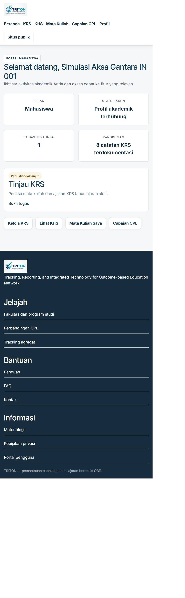
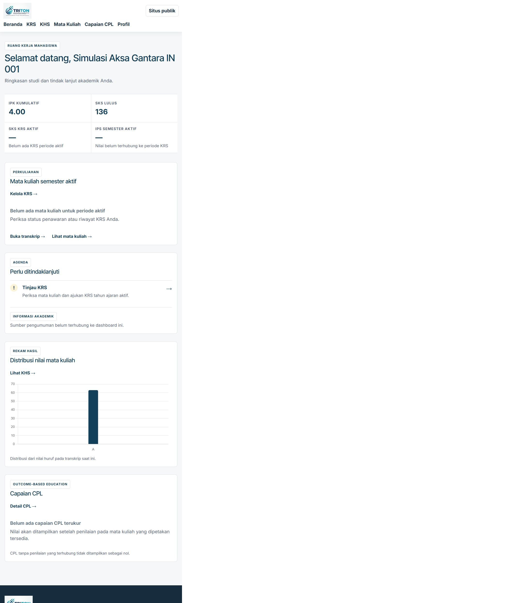
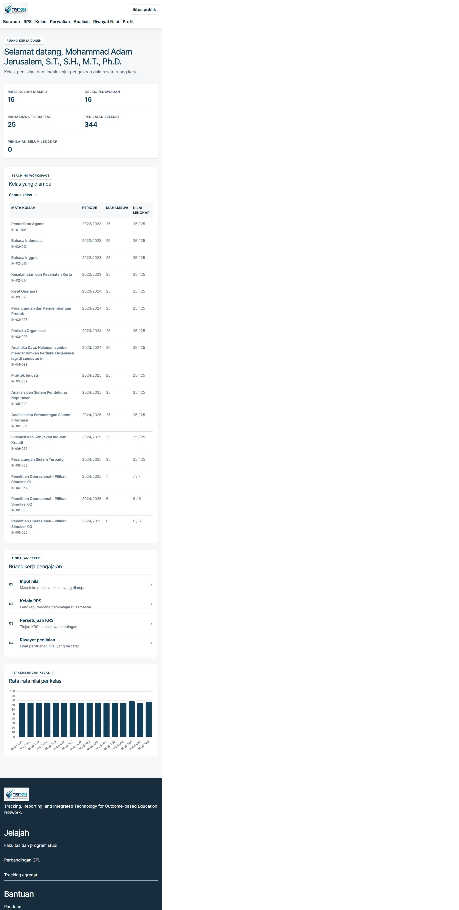

# TRITON Portal Audit Report

## 1. Kondisi awal

Odoo 19 berjalan pada database development `erpobe`. Proses Odoo awal tidak aktif dan
diaktifkan dengan port 8069. Audit menemukan logo berupa mark “T” pada navbar/footer
dan login website masih menampilkan identitas Odoo/My Website. Upgrade awal login
juga memunculkan error XPath Odoo 19 yang kemudian diperbaiki.

## 2. Halaman yang diaudit

- `/` — homepage publik
- `/web/login` — login
- `/fakultas` — daftar fakultas
- `/tentang` — informasi publik
- `/my/triton` — dashboard mahasiswa/dosen
- `/my/profil` — profil mahasiswa/dosen
- `/my/krs` — KRS mahasiswa
- `/my/khs` — KHS mahasiswa
- `/my/kelas` — kelas dosen
- `/my/kelas/1/nilai` — input nilai
- `/my/riwayat-nilai` — audit perubahan nilai
- `/my/krs` sebagai dosen — pengujian otorisasi lintas role

## 3. Screenshot sebelum perubahan

Screenshot browser awal menunjukkan mark “T”, bukan asset JPEG resmi. Login awal
menampilkan logo perusahaan My Website dan footer Odoo. Bukti browser disimpan pada
sesi audit dan laporan ini mencatat hasil inspeksi aktual.

## 4. Masalah visual

- Logo generik “T” masih digunakan pada navbar dan footer.
- Login website menampilkan logo My Website dan footer template bawaan.
- Profil mahasiswa belum menyediakan field data akun.
- Riwayat perubahan nilai belum tersedia.
- Terdapat class/kode style lama yang masih memerlukan konsolidasi design system.

## 5. Masalah fungsional

- `/my/profil` semula hanya menyimpan opt-out publik.
- Field `mobile` yang tidak tersedia pada `res.partner` Odoo 19 menyebabkan 500
  pada `/my/profil`; field tersebut sudah dihapus.
- Tidak ada audit trail immutable untuk perubahan nilai komponen.
- Dosen belum memiliki halaman riwayat perubahan nilai.
- Dashboard dosen/mahasiswa masih berisi shortcut mahasiswa pada dashboard dosen
  dan belum sepenuhnya merupakan academic ERP workspace.

## 6. Masalah security

- Mahasiswa tidak diizinkan mengubah field akademik dari portal.
- Dosen dibatasi pada `line` yang menjadi koordinator atau tim pengampu.
- Pengujian dosen pada `/my/krs` menghasilkan 403 karena profil mahasiswa tidak ada.
- Audit history difilter berdasarkan baris penawaran yang dimiliki dosen.

## 7. Perubahan yang dilakukan

- Mengganti mark “T” dengan logo resmi pada navbar dan footer.
- Menambahkan login inheritance untuk layout web dan web login.
- Menambahkan halaman profil dengan nama, email, telepon, alamat, kota, dan opt-out.
- Menambahkan model immutable `erpobe.grade.komponen.audit`.
- Menambahkan audit entry pada create/write grade komponen.
- Menambahkan route dan template `/my/riwayat-nilai`.
- Menambahkan link Riwayat Nilai pada portal dosen.
- Menambahkan CSS profil dan responsif.
- Memperbaiki login XPath untuk Odoo 19.

## 8. File yang dimodifikasi

- `__manifest__.py`
- `controllers/portal_dosen.py`
- `controllers/portal_mahasiswa.py`
- `models/grade.py`
- `security/ir.model.access.csv`
- `static/src/scss/components/_navigation.scss`
- `static/src/scss/components/_portal.scss`
- `static/src/scss/components/_responsive.scss`
- `views/website/components/portal_navigation.xml`
- `views/website/components/website_navigation.xml`
- `views/website/portal/portal_profile.xml`
- `views/website/portal/teacher/portal_grades.xml`

## 9. File baru

- `.github/skills/odoo19-portal-uiux-qa/SKILL.md`
- `.github/skills/odoo19-portal-uiux-qa/references/design-system.md`
- `.github/skills/odoo19-portal-uiux-qa/references/odoo19-frontend.md`
- `.github/skills/odoo19-portal-uiux-qa/references/qa-checklist.md`
- `.github/skills/odoo19-portal-uiux-qa/templates/audit-report.md`
- `views/website/components/login_branding.xml`
- `docs/TRITON_PORTAL_AUDIT_REPORT.md`
- `docs/TRITON_PORTAL_QA_CHECKLIST.md`

## 10. Hasil pengujian mahasiswa

- Login `mhs.ti.2022.001`: PASS.
- Dashboard `/my/triton`: PASS.
- KRS `/my/krs`: PASS, menampilkan status 19/24 dan empty state penawaran aktif.
- KHS `/my/khs`: PASS, menampilkan transkrip dan PDF.
- Profil: PASS, render 200 dan menyimpan telepon/kota ke database.
- Logout: PASS, kembali ke login.

## 11. Hasil pengujian dosen

- Login `dosen.mohammad_adam_jerusalem`: PASS.
- Dashboard: PASS.
- Kelas: PASS.
- Input nilai: PASS, HTTP 200, nilai baru 71 tersimpan dan dikembalikan ke 91.
- Audit trail: PASS, lama 91 → baru 71 → tampilan dosen.
- Riwayat: PASS.

## 12. Website publik

- Homepage: PASS.
- Logo navbar/footer: PASS.
- Asset static: HTTP 200 image/jpeg.
- Login: PASS dengan hanya logo TRITON.
- Fakultas/tentang: dibuka dalam audit awal.

## 13. Responsive testing

- Desktop 1440×900: PASS tanpa horizontal overflow pada homepage.
- Laptop 1366×768: PASS untuk input nilai.
- Tablet 768×1024: PASS pada pengukuran akhir homepage.
- Mobile 390×844: tidak ada elemen yang melampaui batas pada pemeriksaan konsisten,
  tetapi perlu screenshot penuh ulang pada build final.
- Mobile 360×800: NOT TESTED.

## 14. Security testing

- Dosen mengakses `/my/krs`: PASS 403.
- Mahasiswa tidak memiliki field akademik editable di template profil: PASS.
- Akses lintas dosen telah dibatasi pada controller `_authorized_teacher_line`.

## 15. Screenshot sesudah perubahan

Browser menghasilkan screenshot homepage, login, profil, riwayat nilai, desktop,
tablet, dan mobile sementara pada sesi `/tmp`. Screenshot adalah bukti inspeksi
runtime, namun belum dipindahkan ke folder deliverable permanen.

## 16. Masalah yang belum terselesaikan

- Banyak fitur masih membutuhkan QA browser menyeluruh (CPL detail, RPS, perwalian,
  password change, upload, PDF, sorting/filter/pagination).
- Dashboard dosen/mahasiswa sudah diperbarui pada Phase 2, namun detail analitik
  lanjutan masih perlu pengembangan.
- Audit trail reason belum diproses dari form; field tersedia tetapi form belum
  mengirim alasan perubahan.
- Input penilaian memerlukan 6–7 detik pada submit kelas dan perlu optimisasi N+1.
- Screenshot permanen Phase 2 tersimpan di `docs/screenshots/`; baseline dosen belum
  tersedia.

## 17. Phase 2 — workspace dashboard

### Perubahan

- Dashboard mahasiswa kini mengambil IPK dan SKS lulus dari transkrip KHS, daftar
  mata kuliah/SKS dari KRS pada tahun ajaran aktif, distribusi nilai huruf dari
  baris KHS, dan capaian CPL hanya ketika seluruh CPMK yang dipetakan memiliki
  nilai serta semua komponen penilaian terkait tersedia. Nilai CPL dashboard
  merupakan rerata tanpa bobot dari CPMK yang dipetakan; relasi CPMK→CPL hanya
  menentukan pemetaan. IPS semester aktif dinyatakan belum tersedia karena nilai
  mata kuliah tersimpan tanpa relasi periode yang cukup untuk menghitung IPS per
  semester secara akurat.
- Dashboard dosen kini memisahkan tugas mengajar, daftar kelas, jumlah mahasiswa,
  kelengkapan penilaian, tautan input nilai/RPS/perwalian/riwayat, dan rata-rata
  nilai kelas berdasarkan grade mata kuliah tersimpan.
- Grafik menggunakan Chart.js milik Odoo 19. Data kosong menampilkan empty state,
  bukan angka nol buatan. Pengumuman belum dihubungkan dan dinyatakan jelas.
- Tidak ada perubahan pada nilai, KRS, atau data profil fixture.

### Bukti visual

Baseline mahasiswa diambil sebelum perubahan pada viewport browser awal 607 CSS px.
Screenshot dosen sebelum perubahan tidak tersedia pada sesi ini; screenshot dosen
di bawah hanya menunjukkan hasil sesudah.

| Halaman | Sebelum | Sesudah |
|---|---|---|
| Mahasiswa |  |  |
| Dosen | Belum direkam |  |

Responsive mahasiswa: [tablet](screenshots/student-dashboard-tablet.jpg),
[390×844](screenshots/student-dashboard-mobile-390.jpg), dan
[360×800](screenshots/student-dashboard-mobile-360.jpg). Dosen:
[390×844](screenshots/teacher-dashboard-mobile-390.jpg).

### Pengujian dan hasil

- Upgrade `erpobe` pada database development berhasil; registry termuat dan aset
  Chart.js serta modul dashboard mengembalikan HTTP 200.
- Browser mahasiswa: route `/my/triton` berhasil, IPK 4.00 dan SKS lulus 136
  berasal dari KHS; Chart.js aktif dan grafik distribusi nilai dirender. Tidak ada
  capaian CPL yang memenuhi syarat penilaian lengkap, sehingga empty state tampil.
- Browser dosen: route `/my/triton` berhasil; 16 mata kuliah/kelas, 25 mahasiswa
  unik, 344 penilaian mahasiswa-kelas selesai, dan 0 penilaian belum lengkap
  berasal dari penawaran/KRS/nilai komponen. Grafik rata-rata kelas dirender.
- Satu 500 terdeteksi pada uji awal setelah perubahan agregasi CPL; guard diperbaiki
  agar hasil hanya dihitung ketika seluruh data komponen tersedia. Uji ulang
  mahasiswa dan dosen berhasil. Tidak ditemukan error JavaScript atau respons gagal
  saat reload akhir kedua dashboard. Log masih memuat error dari uji awal dan
  error historis sebelum perubahan; tidak diklaim sebagai hasil akhir. Pengalihan
  akun melalui helper uji yang meminta `GET /web/logout` menerima 404, sehingga
  helper tersebut bukan bukti alur logout berhasil dan logout belum dinyatakan lulus.
- Tidak ada overflow horizontal pada viewport terukur 1440×900, 1367×767,
  767×1024, 390×844, dan 360×800 untuk mahasiswa; dosen juga lolos pada 1440×900
  dan 390×844. Browser automation membulatkan 1366×768 dan 768×1024 menjadi
  1367×767 dan 767×1024. Tabel dosen tetap memakai area scroll horizontal
  tersendiri pada mobile, dan navigasi portal menggunakan baris tautan geser.

### Pekerjaan Phase 2 berikutnya

- Detail mata kuliah KHS/CPMK dan analitik CPL (radar, kontribusi mata kuliah,
  riwayat) belum dikerjakan pada slice ini.
- Input nilai bulk, audit trail dengan alasan/filter, optimasi submit 6–7 detik,
  foto/password profil, RPS/perwalian, website publik, dan permanent Playwright
  suite masih belum diuji atau diselesaikan.
- Dashboard dosen sebelum perubahan belum memiliki screenshot pembanding.
