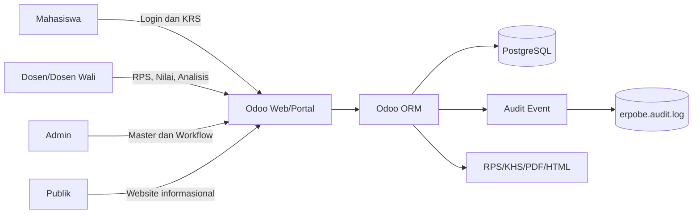
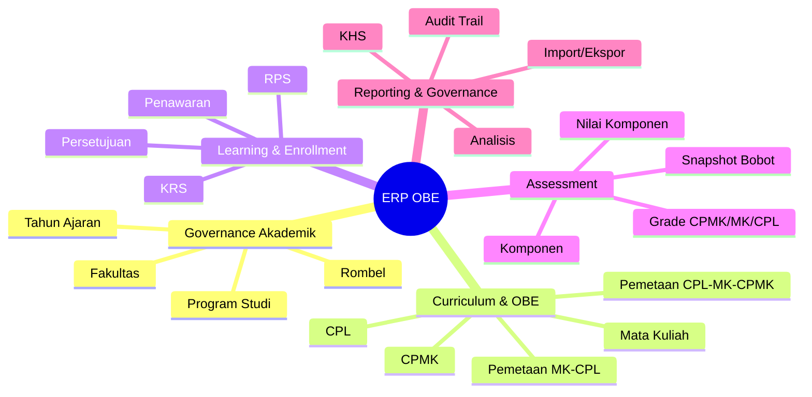
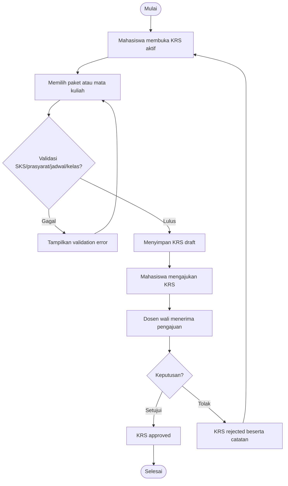
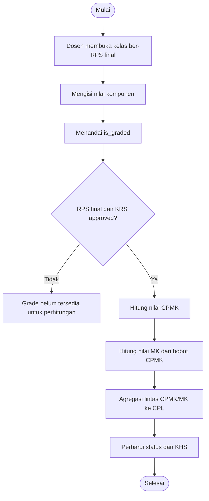
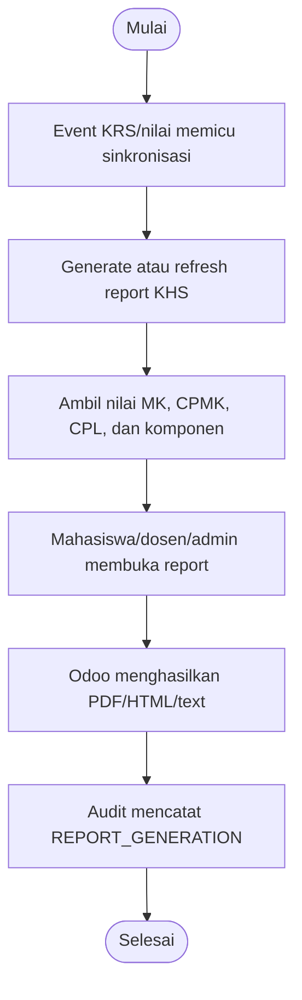
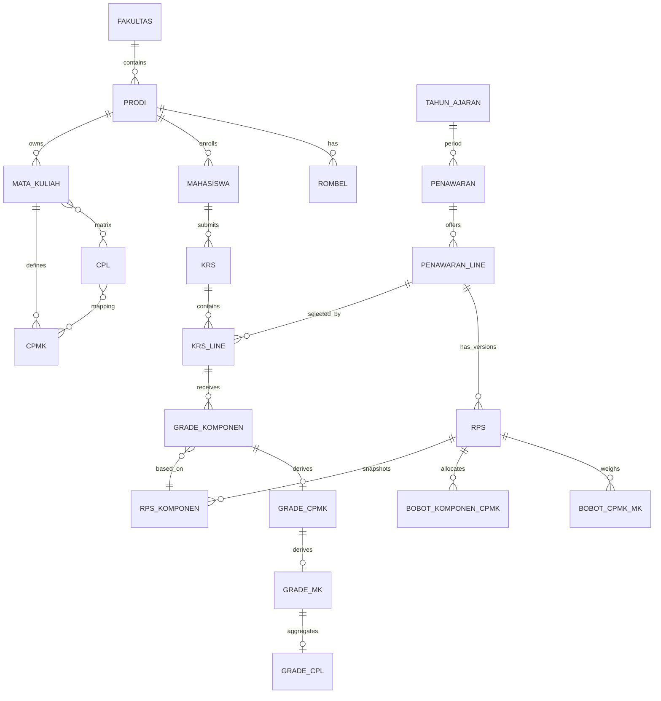
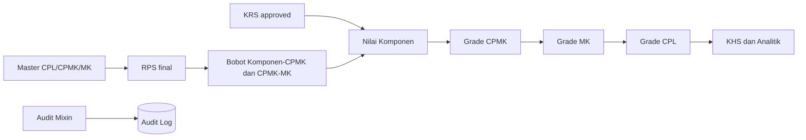
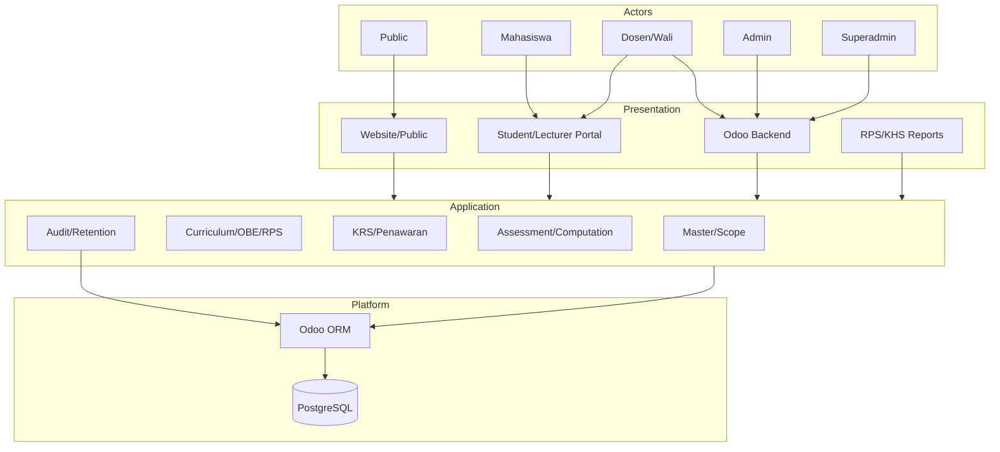
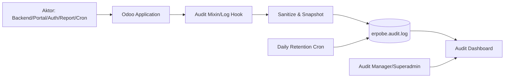

# ENTERPRISE ARCHITECTURE

## ERP OBE — Odoo 19

### Document Information

| Item | Nilai |
|---|---|
| Project | ERP OBE — Custom Enterprise Resource Planning berbasis Odoo 19 |
| Document | Enterprise Architecture ERP OBE |
| Scope | Addon kustom `custom_module/erpobe` |
| Framework | TOGAF Architecture Development Method (ADM) |
| Process notation | BPMN 2.0 sebagai standar konseptual; Mermaid hanya digunakan sebagai representasi pendukung |
| Module version | `19.0.2.8.0` |
| Analysis date | 24 November 2026 |
| Status | Berdasarkan reverse engineering source code |

## 1. Executive Summary

ERP OBE merupakan aplikasi Odoo 19 kustom untuk pengelolaan master akademik, kurikulum, Outcome-Based Education (OBE), perkuliahan, penilaian, dan pelaporan. Implementasi aktual memiliki satu addon, `erpobe`, dengan model ORM, view backend, portal dosen dan mahasiswa, portal publik, wizard import/ekspor, laporan QWeb, bantuan akademik, dan infrastruktur audit terpusat.

Rantai OBE yang terverifikasi adalah:

**CPL ← pemetaan ← CPMK ← bobot CPMK/Mata Kuliah ← Mata Kuliah ← RPS ← Komponen Penilaian ← Nilai Komponen**

Logika implementasi tidak menggunakan Sub-CPMK. Pemetaan CPMK–CPL tidak memiliki bobot CPMK–CPL; kontribusi dihitung melalui nilai CPMK dan pemetaan CPMK/ mata kuliah terhadap CPL. Perhitungan detail tersedia hanya dengan RPS `final`, KRS `approved`, dan grade komponen bertanda `is_graded=True`.

Audit Trail Phase 5 terimplementasi sebagai mixin ORM, model log terpusat, dashboard, autentikasi, audit laporan, retensi, dan aturan akses. Versi modul menyatakan `19.0.2.8.0`. Tidak ditemukan bukti deployment produksi atau integrasi eksternal berkelanjutan. Oleh sebab itu, teknologi aktual dibatasi pada sumber repository dan tidak mengklaim Docker, Kubernetes, Nginx, cloud, load balancer, broker pesan, atau API eksternal.

Ruang lingkup metodologi hanya mencakup Preliminary, Phase A, Phase B, Phase C, Phase D, Gap Analysis, dan rekomendasi roadmap. Phase E–H tidak dinyatakan sebagai hasil pelaksanaan penelitian.

## 2. Pendahuluan

### 2.1 Latar Belakang

Pengelolaan capaian pembelajaran memerlukan hubungan yang dapat ditelusuri dari CPL sampai nilai mahasiswa. Dokumen ini menyajikan arsitektur aktual yang hasilnya berasal dari pemeriksaan manifest, model, field, relasi, constraint, controller, view, security, wizard, migration, report, cron, dan test.

### 2.2 Tujuan Enterprise Architecture

1. Memetakan konteks bisnis, proses akademik, dan stakeholder.
2. Mendokumentasikan data dan relasi OBE secara faktual.
3. Memetakan komponen aplikasi dan dukungan proses bisnis.
4. Mendokumentasikan teknologi, deployment, security, dan audit aktual.
5. Memisahkan kondisi As-Is, To-Be, gap, dan recommendation.
6. Menyediakan traceability untuk penggunaan dalam metodologi skripsi.

### 2.3 Metodologi

TOGAF ADM mengorganisasikan hasil reverse engineering. BPMN dipakai untuk proses bisnis utama. Dokumen lama bukan bukti utama apabila bertentangan dengan source code.

### 2.4 Metode Reverse Engineering

Pemeriksaan dilakukan terhadap:

- `__manifest__.py`, dependency, asset, dan urutan loading.
- model ORM dan seluruh relasi, constraint, computed field, dan method.
- view, menu, action, portal, dan laporan.
- ACL, record rules, grup, dan pengecekan ownership.
- controller, wizard, cron, migration, dan test.
- implementasi audit dan jalur autentikasi/laporan.

### 2.5 Batasan

- Tidak ada perubahan source code, model, database, view, security, endpoint, atau konfigurasi.
- Lingkungan produksi tidak dapat diverifikasi dari repository.
- Dokumen lama hanya dipakai sebagai konteks historis.
- Nilai fixture dan hasil seed dibedakan dari nilai operasional aktual.
- Tidak ada bukti eksekusi penuh suite test pada saat penyusunan dokumen ini.

# 3. Preliminary Phase

## 3.1 Architecture Context

ERP OBE mendukung pengelolaan akademik satu proyek Odoo 19. Konteks utamanya meliputi organisasi akademik, kurikulum, dosen, mahasiswa, perkuliahan, penilaian, capaian, pelaporan, dan audit.

## 3.2 Architecture Scope

| Scope | Dalam Cakupan | Batas |
|---|---|---|
| Organization | Fakultas, prodi, dosen, mahasiswa, rombel | Tidak memodelkan SIMAK eksternal |
| Curriculum | Mata kuliah, kurikulum, CPL, CPMK | Tanpa Sub-CPMK |
| Learning plan | RPS, komponen, kegiatan, bobot | Status final dan snapshot RPS |
| Enrollment | Penawaran, KRS, approval dosen wali | Tidak ditemukan integrasi SIAKAD eksternal |
| Assessment | Nilai komponen, CPMK, MK, CPL | Tidak ada perubahan formula kode |
| Reporting | KHS, report, summary, portal | Tidak ada bukti dashboard eksekutif eksternal |
| Governance | ACL, record rules, audit, retensi | Infrastruktur produksi belum terverifikasi |

## 3.3 Architecture Principles

| Principle | Description | Rationale | Implication | Implementation Evidence |
|---|---|---|---|---|
| Business-driven | Arsitektur mengikuti proses akademik dan OBE | Capaian harus dapat ditelusuri | Keterhubungan domain tidak boleh diputus | Model mata kuliah, CPL, CPMK, RPS, KRS, nilai |
| Data consistency | Relasi dan constraint menjadi penjaga integritas | Data akademik sensitif | Unique dan cross-model constraint diterapkan | SQL constraints dan Python validation |
| Modular application | Satu addon dengan komponen fungsi terpisah | Mengurangi perubahan lintas domain | Model, view, wizard, dan controller tetap terpisah | Struktur direktori `erpobe` |
| Security by design | Hak akses diterapkan melalui Odoo ACL dan rules | Pembatasan kebutuhan akademik | Cakupan prodi dan kepemilikan perlu konsisten | `security/groups.xml`, `rules.xml`, `ir.model.access.csv` |
| Traceability | Perubahan nilai dan aktivitas dapat dilacak | Akuntabilitas akademik | Event audit harus menyertakan actor dan record | `erpobe.audit.mixin`, `erpobe.audit.log` |
| Snapshot stability | RPS dan komponen digunakan sebagai snapshot | Bobot masa lalu tidak berubah diam-diam | Koneksi grade menggunakan RPS dan snapshot komponen | `rps_komponen`, `rps.lock.mixin`, migration |
| Maintainability | Field dan method terkait ditempatkan per domain | Mempermudah perubahan terarah | Tidak menulis ulang logika lintas model | Direktori model per domain |

## 3.4 Stakeholder Identification

| Stakeholder | Kepentingan | Concern |
|---|---|---|
| Mahasiswa | KRS, nilai, KHS, CPL | Privasi dan data dirinya |
| Dosen | RPS, kelas, penilaian, analisis | Akses kelas/prodi yang relevan |
| Dosen wali | Pengajuan dan persetujuan KRS | Batas mahasiswa bimbingan |
| Admin akademik | Master, workflow, import/ekspor | Konsistensi data dan cakupan prodi |
| Superadmin | Administrasi global dan audit | Perlindungan integritas dan retensi |
| Audit manager | Pemeriksaan aktivitas | Akses log tanpa hak mutasi biasa |
| Program Studi | Pengelolaan kurikulum dan capaian | Akurasi pemetaan dan agregasi |

## 3.5 Architecture Approach

Pendekatan actual-state architecture dilakukan melalui source-based evidence, sedangkan target state dibatasi pada kebutuhan yang dapat ditelusuri dan recommendation yang belum diterapkan. Gap dipetakan berdasarkan bukti aktual, bukan daftar fitur asumsi.

# 4. Phase A — Architecture Vision

## 4.1 Business Context

Pengelolaan akademik melibatkan master organisasi, kurikulum OBE, penawaran kelas, registrasi mata kuliah, penyusunan RPS, penilaian, dan pelaporan. Sistem perlu menjaga identitas mahasiswa, dosen, kelas, RPS, snapshot komponen, dan hasil perhitungan.

## 4.2 Problem Statement

Masalah utama yang diatasi sistem adalah keterhubungan proses akademik dan capaian, pembatasan hasil mahasiswa berdasarkan kepemilikan dan prodi, konsistensi bobot RPS, serta kebutuhan audit atas perubahan dan pembuatan laporan. Kesenjangan yang tersisa adalah pemerataan record rules pada seluruh model, verifikasi deployment produksi, dan otomatisasi observability.

## 4.3 Architecture Vision



## 4.4 Business Goals

| Goal | Outcome |
|---|---|
| Konsistensi data akademik | Fakultas, prodi, mahasiswa, dosen, mata kuliah, dan rombel saling valid |
| Capaian terukur | CPL memiliki nilai dari CPMK dan pemetaan kurikulum |
| RPS stabil | Komponen dan bobot disimpan sebagai snapshot per RPS |
| Enrolment terkendali | KRS dibatasi SKS, kelas, rombel, prasyarat, dan persetujuan |
| Pelaporan tersedia | KHS dan report dapat dijalankan backend/portal |
| Audit dapat dipertanggungjawabkan | Perubahan, workflow, report, autentikasi, dan retensi tercatat |

## 4.5 Architecture Scope

Cakupan merupakan addon tunggal yang memanfaatkan Odoo core untuk authentication, company, mail, activity, web, portal, dan reporting. Integrasi antaraddon tidak mencakup sistem eksternal.

# 5. Phase B — Business Architecture

## 5.1 Business Actors

- **Mahasiswa:** mengelola dan mengajukan KRS, membaca kelas dan KHS.
- **Dosen:** menyusun RPS, mengelola kelas, memasukkan nilai, membaca analisis.
- **Dosen wali:** menyetujui atau menolak KRS mahasiswa bimbingan.
- **Admin:** mengelola data dan melakukan import/ekspor dalam cakupan prodi.
- **Superadmin:** akses global dan pengelolaan audit.
- **Public:** mengakses halaman informasional publik.

## 5.2 Business Capability Map



## 5.3 Process Catalog

| Process | As-Is evidence | To-Be behavior | Primary data |
|---|---|---|---|
| Pengelolaan fakultas/prodi | Tidak ada bukti end-to-end dokumentasi lama | Admin mengelola data berdasarkan scope | Fakultas, Prodi |
| Pengelolaan dosen/mahasiswa | Profile linked to partner/user | Admin membuat dan memvalidasi profil | Dosen, Mahasiswa, res.users |
| Pengelolaan tahun/rombel | Fixture dan master tersedia | Data semester dan rombel dikelola | Tahun Ajaran, Rombel |
| Pengelolaan mata kuliah | Model master dan constraint tersedia | Mata kuliah dipetakan ke prodi dan CPMK | Mata Kuliah, CPMK |
| Pengelolaan CPL/CPMK | Pemetaan model tersedia | CPL dan CPMK dikelola terpisah dan terhubung | CPL, CPMK, mapping |
| Penyusunan RPS | Ada workflow draft/review/final | RPS divisualkan, disalin, divalidasi bobot, lalu difinalkan | RPS, snapshot komponen |
| Penawaran kelas | Penawaran dan line tersedia | Admin membentuk kelas, jadwal, dan rombel | Penawaran, Penawaran Line |
| Pengajuan KRS | Ada draft/submitted/approved/rejected | Mahasiswa mengisi, dosen wali memutuskan | KRS, KRS Line |
| Penilaian | Grade komponen tersedia | Dosen memasukkan nilai dan menghitung hasil | Grade Komponen |
| Perhitungan OBE | Formula code tersedia | CPMK → MK → CPL dihitung dengan gate status | Grade CPMK/MK/CPL |
| KHS dan pelaporan | Report model dan QWeb tersedia | KHS/summary/RPS dipublikasikan sebagai PDF/HTML/text | Report KHS |
| Audit | Mixin dan log tersedia | Aktor, perubahan, workflow, dan report dicatat | Audit Log |

## 5.4 Business Process As-Is

Tidak ada bukti lengkap untuk proses akademik manual sebelum ERP. Dokumen tidak membangun klaim As-Is detail yang tidak didukung. Kondisi As-Is yang dapat disimpulkan adalah proses masih bergantung pada master dan formulir terpisah/eksternal ketika ERP tidak tersedia. Bukti formal proses lama tidak tersedia.

## 5.5 Business Rules

- RPS memiliki status `draft`, `review`, dan `final`.
- Finalisasi RPS memerlukan bobot lengkap dan valid.
- RPS final bersifat snapshot terhadap komponen dan bobot yang digunakan.
- KRS memiliki status `draft`, `submitted`, `approved`, dan `rejected`.
- Mahasiswa tidak dapat mengubah KRS setelah diajukan; dosen wali hanya memproses mahasiswa bimbingannya.
- Pembatasan maksimal SKS adalah 24 pada model KRS.
- KRS baru harus memenuhi prasyarat dan tidak bentrok jadwal pada validasi yang tersedia.
- Nilai CPMK dihitung dari bobot komponen terhadap CPMK.
- Nilai MK dihitung dari bobot CPMK terhadap MK.
- Nilai CPL dihitung lintas mata kuliah dan CPMK yang dipetakan; tidak ada bobot CPMK–CPL.
- CPL dapat berstatus `belum_tersedia`, `dalam_proses`, `tercapai`, atau `belum`.

## 5.6 BPMN Supporting Representations

Diagram di bawah merupakan representasi alur pendukung dalam Mermaid. Mereka tidak disajikan sebagai artefak BPMN 2.0 XML formal.

### 5.6.1 Penyusunan dan Finalisasi RPS

```mermaid
flowchart TD
    S([Mulai]) --> A[Dosen memilih penawaran dan membuat RPS]
    A --> B[Dosen menyusun CPMK, komponen, dan bobot]
    B --> C{Bobot lengkap dan valid?}
    C -->|Tidak| D[Tandai weight issue / revisi]
    D --> B
    C -->|Ya| E[Dosen meninjau RPS]
    E --> F{Siap final?}
    F -->|Belum| G[Kembalikan ke draft/review]
    G --> B
    F -->|Ya| H[Finalisasi RPS]
    H --> I[(RPS final dan snapshot]
    I --> Z([Selesai])
```

Tujuannya memastikan RPS final memiliki snapshot komponen dan bobot yang valid. Aktor utama adalah dosen/admin sesuai hak akses.

### 5.6.2 Pengisian dan Persetujuan KRS



### 5.6.3 Pelaksanaan Penilaian dan Capaian OBE



### 5.6.4 KHS dan Pelaporan



## 5.7 Business-to-Application Mapping

| Process | Component | Model utama |
|---|---|---|
| Master akademik | Master Data Akademik | `erpobe.master.fakultas`, `erpobe.master.prodi`, `erpobe.master.rombel` |
| User profile | User and Faculty Scope | `erpobe.master.dosen`, `erpobe.master.mahasiswa`, `res.users` |
| Kurikulum/OBE | Curriculum and OBE | `erpobe.akademik.cpl`, `erpobe.akademik.cpmk`, mapping models |
| RPS | RPS and Assessment | `erpobe.akademik.rps`, `erpobe.akademik.rps.komponen` |
| Penawaran | Course Offering | `erpobe.akademik.penawaran`, `...penawaran.line` |
| KRS | KRS Management | `erpobe.akademik.krs`, `erpobe.akademik.krs.line` |
| Nilai | Academic Assessment | `erpobe.input.nilai`, `erpobe.grade.*` |
| Pelaporan | Reporting | `erpobe.report.khs`, `erpobe.summary.*` |
| Audit | Audit and Governance | `erpobe.audit.log`, `erpobe.audit.dashboard` |

# 6. Phase C — Data Architecture

## 6.1 Data Domains

| Domain | Entitas utama |
|---|---|
| Organization | Fakultas, Prodi |
| Academic Master | Tahun Ajaran, Rombel, Mata Kuliah, Grade |
| Curriculum and OBE | CPL, CPMK, mapping CPL–MK–CPMK, mapping MK–CPL |
| User | Dosen, Mahasiswa, res.users, res.partner |
| Learning Plan | RPS, komponen RPS, kegiatan, rubrik, bobot |
| Transaction | Penawaran, line penawaran, KRS, line KRS |
| Assessment | Grade komponen, grade CPMK, grade MK, grade CPL |
| Reporting | Report KHS dan detail MK/CPMK/CPL/komponen |
| Audit | Audit log, audit dashboard, auth/report/import/export events |

## 6.2 Logical OBE and Academic Model



Cardinality di atas merupakan model konseptual yang merepresentasikan relasi ORM. Beberapa relasi CPL/CPMK dan MK/CPL berupa tabel pemetaan Odoo dengan constraint unik.

## 6.3 Primary Models and Relations

| Model | Key relations | Role |
|---|---|---|
| `erpobe.master.fakultas` | one-to-many prodi | Unit organisasi |
| `erpobe.master.prodi` | many-to-one fakultas | Unit akademik |
| `erpobe.master.mahasiswa` | inherits res.partner; one-to-many KRS/grade | Actor dan transaksi mahasiswa |
| `erpobe.master.dosen` | inherits res.partner; many-to-many prodi | Actor dan scope dosen |
| `erpobe.master.matakuliah` | many-to-one prodi; many-to-one/two prasyarat | Master mata kuliah |
| `erpobe.akademik.cpl` | many-to-one prodi | Hasil pembelajaran lulusan |
| `erpobe.akademik.cpmk` | many-to-one mata kuliah | Capaian mata kuliah |
| `erpobe.akademik.cpl.mk.cpmk` | CPL, CPMK | Pemetaan CPL–CPMK |
| `erpobe.akademik.mk.cpl` | MK, CPL | Matriks MK–CPL |
| `erpobe.akademik.rps` | many-to-one MK/penawaran line | Rencana pembelajaran dan snapshot |
| `erpobe.akademik.rps.komponen` | many-to-one RPS/komponen | Snapshot bobot komponen |
| `erpobe.bobot.komponen.cpmk` | RPS, snapshot komponen, CPMK | Bobot komponen → CPMK |
| `erpobe.bobot.cpmk.mk` | RPS, CPMK | Bobot CPMK → MK |
| `erpobe.akademik.penawaran` | many-to-one tahun; many-to-many rombel | Penawaran semester |
| `erpobe.akademik.krs` | many-to-one mahasiswa/penawaran | Header KRS |
| `erpobe.grade.komponen` | many-to-one KRS line/RPS/snapshot | Nilai mentah |
| `erpobe.grade.cpmk` | mahasiswa, CPMK, KRS line, RPS | Nilai CPMK |
| `erpobe.grade.mk` | mahasiswa, MK, KRS line, RPS | Nilai MK |
| `erpobe.grade.cpl` | mahasiswa, CPL | Agregat CPL lintas MK |
| `erpobe.report.khs` | mahasiswa plus detail/report | Dokumen KHS |
| `erpobe.audit.log` | many-to-one res.users/company | Riwayat audit |

## 6.4 Data Integrity

Data integrity dijaga dengan:

- `_sql_constraints` dan `models.Constraint` untuk duplikasi dan identitas unik.
- `@api.constrains` untuk relasi lintas model, SKS, prasyarat, jadwal, dan scope.
- RPS lock mixin untuk melindungi baris tertentu setelah RPS final.
- Snapshot RPS komponen agar penilaian mempertahankan lineage.
- `ondelete=restrict` pada relasi nilai KRS/RPS agar record capaian tidak mudah putus.
- Nilai computed dan store untuk rekonsiliasi OBE.

## 6.5 Data Flow



## 6.6 Data-to-Application Mapping

| Domain data | Application component |
|---|---|
| Organization/master | Backend views, profile, import wizard |
| OBE | CPL/CPMK, mapping, RPS views |
| Enrollment | Penawaran/KRS views dan portal |
| Assessment | Grade and RPS views |
| Reporting | Report KHS, summary analytics, public/portal QWeb |
| Audit | Audit log/dashboard and authentication/report hooks |

# 7. Phase C — Application Architecture

## 7.1 Application Landscape



## 7.2 Application Components

| Component | Responsibility | Evidence |
|---|---|---|
| Master Academic | Fakultas, prodi, mata kuliah, rombel, tahun | Model dan view master |
| User/Scope | Profil dosen/mahasiswa, hak prodi | `master_user.py`, `faculty_access.py`, rules |
| Curriculum/OBE | CPL, CPMK, mapping MK | Model akademik dan view |
| RPS/Assessment | RPS, komponen, bobot, lock | RPS models dan wizard copy |
| Course Offering | Penawaran dan line | Penawaran model/view |
| KRS | Draft hingga approval | KRS model dan portal |
| Academic Assessment | Grade komponen/CPMK/MK/CPL | Grade model |
| Reporting | KHS dan summary | Report model/QWeb |
| Import/Ekspor | Wizard dan template | Wizard mixin dan import models |
| Portals | Fungsi dosen/mahasiswa/publik | Controllers and QWeb |
| Academic Assistant | Pencarian informasi berbasis halaman/konteks | OWL/JS dan controller |
| Audit | Log, auth, report, dashboard, cleanup | Audit models/controller/cron |

## 7.3 Application Interaction

1. Pengguna membuka backend atau portal.
2. Controller/view memanggil model melalui Odoo ORM.
3. Model menjalankan constraint dan computed field.
4. Audit mixin mencatat create/update/delete/workflow pada model yang menginherit-nya.
5. Report hook mencatat pembuatan PDF/HTML/text.
6. Cron melakukan cleanup audit yang kedaluwarsa.
7. Portal dan backend membaca ORM sesuai ACL dan record rules.

## 7.4 Application-to-Business Matrix

| Component | Master | Curriculum | RPS | Offering | KRS | Assessment | KHS | Audit |
|---|---|---|---|---|---|---|---|---|
| Master Academic | Penuh | Sebagian | - | - | - | - | - | Terintegrasi |
| Curriculum/OBE | - | Penuh | Penuh | - | - | Penuh | Sebagian | Terintegrasi |
| RPS/Assessment | - | Penuh | Penuh | Penuh | - | Penuh | Sebagian | Terintegrasi |
| Course Offering | - | - | Penuh | Penuh | Penuh | - | - | Terintegrasi |
| KRS | - | - | - | Penuh | Penuh | Sebagian | Penuh | Terintegrasi |
| Assessment | - | Penuh | Penuh | Penuh | Penuh | Penuh | Penuh | Terintegrasi |
| Reporting | - | Sebagian | Penuh | - | Penuh | Penuh | Penuh | Terintegrasi |

## 7.5 Application Security

Empat role ERP ditambahkan melalui `groups.xml`: Mahasiswa, Dosen, Admin, Superadmin. Audit Trail Manager juga tersedia sebagai grup terpisah; Superadmin mengimplikasikan Admin dan Audit Trail Manager.

ACL memberi operasi per model, sedangkan record rules membatasi scope prodi/fakultas dan kepemilikan mahasiswa. Beberapa query portal menggunakan `sudo()` dan melakukan pengecekan actor/data secara eksplisit di controller atau model; publikasi informasi publik dirancang untuk diakses tanpa login.

# 8. Audit Trail and Governance Architecture

## 8.1 Centralized Audit

`erpobe.audit.mixin` menangani create, update, dan delete untuk model yang menginherit-nya. Event mencakup perubahan field lama/baru, identitas actor, record, event, severity, status, source, IP/user agent, correlation ID, company, dan metadata.

Nilai sensitif disanitasi: field bernama password/passwd/token/secret/API key/access token/session/credential/binary dan field binary/one2many dikecualikan atau dimasking. Snapshot record dibatasi sekitar 30 field untuk penghindaran beban.

## 8.2 Authentication Audit

Implementasi mencatat:

- `LOGIN_SUCCESS`,
- `LOGIN_FAILED`,
- `LOGOUT`.

Login gagal dicatat melalui cursor independen untuk bertahan pada kegagalan autentikasi. Tidak ada password atau kredensial tersimpan dalam audit; metadata login dibatasi kepada informasi login yang dibutuhkan. Logout dicatat oleh override controller session.

## 8.3 Workflow and CRUD Audit

Mixin memetakan field state/status menjadi action seperti SUBMIT, APPROVE, REJECT, PUBLISH/UNPUBLISH, ARCHIVE/RESTORE. Aktivitas CRUD dicatat sebagai CREATE/UPDATE/DELETE. DELETE menyimpan snapshot atau nama record sebelum penghapusan. Log ikut rollback transaksi melalui satu database transaction.

## 8.4 Report Audit

Override `ir.actions.report` mencatat PDF, HTML, dan text untuk report ERP OBE yang memenuhi filter model/template. Metadata mencakup nama report, template, format, jumlah record, status, dan correlation ID. Report KHS/RPS ditandai sensitif. Deduplikasi dilakukan berdasarkan `correlation_id + action_type` pada `log_event`.

## 8.5 Import and Export Audit

Wizard import/ekspor menggunakan mixin terpisah untuk template, validasi, pembacaan CSV/XLSX, dan operasi bulk. Bukti source tersedia, tetapi pencatatan setiap operasi import/ekspor perlu dilihat per action implementation. Audit model mendukung action IMPORT dan EXPORT; setiap wizard tidak boleh diasumsikan memanggilnya kecuali benar-benar ada kode log.

## 8.6 Portal Audit

Infrastructure mendukung event portal melalui field `source=portal` dan context audit. Pengaksesan baca sensitif tidak otomatis tercatat hanya karena controller dibuka; implementasi harus memanggil `SENSITIVE_ACCESS` secara eksplisit untuk mendapatkan log baca. Pencatatan perubahan dan workflow tetap terjadi pada mixin jika model diwarisi.

## 8.7 Audit Dashboard

Transient model menyediakan KPI:

- total hari ini, tujuh hari, bulan berjalan,
- jumlah create/update/delete,
- workflow,
- record sensitif,
- aktor aktif,
- 20 aktivitas terbaru,
- total expired ordinary/critical,
- status dan last call cron.

## 8.8 Retention

Cron harian aktif untuk `erpobe.audit.log.cleanup_expired_logs()`:

- log biasa: 180 hari;
- log kritis: 365 hari.

Cleanup dibatasi 500 ordinary dan 500 critical per eksekusi. Penghapusan memerlukan context `allow_audit_cleanup` dan actor system/superadmin.

## 8.9 Audit Integrity

`write()` log menolak perubahan tanpa context internal `allow_audit_mutation`. `unlink()` menolak penghapusan pengguna biasa. Immutability mengandalkan context dan guard model, sehingga tidak sama dengan database append-only. Model audit memiliki record rule global hanya untuk Audit Manager, Superadmin, dan System.

## 8.10 Test Evidence

File `tests/test_audit_log.py` memuat sepuluh method pengujian pada penelusuran saat ini:

- CRUD dan sudo actor,
- masking dan immutability,
- unchanged update,
- rollback create,
- archive/restore dashboard,
- rollback update/delete,
- role security,
- authentication success/failed,
- report and retention.

Pengujian ini merupakan bukti test source; tidak ada hasil eksekusi runtime terbaru yang dapat disertakan.

## 8.11 Audit Trail Architecture



# 9. Phase D — Technology Architecture

## 9.1 Technology Stack

| Layer | Technology | Evidence |
|---|---|---|
| ERP platform | Odoo 19 | Manifest and Odoo APIs |
| Language | Python | Model/controller/wizard |
| Database | PostgreSQL | Odoo ORM and SQL audit |
| View | XML, QWeb | Backend and portal templates |
| Frontend | JavaScript, OWL, SCSS/CSS | Assets and academic assistant |
| Reporting | QWeb PDF/HTML/text | ir.actions.report override |
| Spreadsheet | openpyxl, xlsxwriter | External Python dependencies |
| Chart | web.chartjs_lib | Frontend asset |
| Core addons | base, web, website, portal, contacts, mail | Manifest |

## 9.2 Runtime Architecture

Odoo server menjalankan addon dan ORM; PostgreSQL menyimpan model bisnis dan log; browser memuat backend/portal melalui web assets; controller HTTP/JSONRPC menangani portal dan session; cron Odoo menjalankan cleanup audit.

## 9.3 Deployment Architecture

Repository tidak membuktikan server produksi, reverse proxy, containerization, high availability, atau backup. Deployment aktual dibedakan:

| Environment | Evidence | Status |
|---|---|---|
| Development | Source, test, dan fixture lokal | Terverifikasi dari repository |
| Test | TransactionCase dan test tagging | Ada source, eksekusi runtime tidak dilampirkan |
| Production | Tidak ditemukan manifest/infrastruktur | Tidak terverifikasi |

## 9.4 Security Technology

Security diwujudkan oleh Odoo session/authentication, groups, ACL, record rules, owner checks, portal/public routes, audit context, dan PostgreSQL transaction. Tidak ditemukan service authentication eksternal atau API gateway.

## 9.5 Constraints

- Tidak ada scheduled action selain cron audit yang teridentifikasi.
- Tidak ditemukan `base.automation` khusus addon.
- Tidak ditemukan integrasi external API pada code yang ditinjau.
- Penggunaan `sudo()` terbatas dan perlu trace per controller.
- Production backup/retention external tidak dapat diverifikasi.

# 10. Architecture Gap Analysis

## 10.1 Gap Classification

| No | Domain | As-Is | To-Be | Gap | Dampak | Prioritas |
|---|---|---|---|---|---|---|
| 1 | Business | Draft As-Is manual tidak terdokumentasi dengan bukti | Proses lama dan transisi tersedia secara terukur | Bukti proses lama belum lengkap | Risiko asumsi proses | Medium |
| 2 | Business | RPS, KRS, nilai, dan KHS tersedia | Semua proses tereksekusi end-to-end terkontrol | Belum terdapat bukti eksekusi produksi | Gap verifikasi operasional | High |
| 3 | Data | Banyak master dan hubungan terimplementasi | Data governance lintas model konsisten | Cakupan rules tidak seragam pada setiap model | Risiko ketimpangan akses | High |
| 4 | Data | Constraint dan snapshot tersedia | Dapat direkonsiliasi lintas versi RPS | Rekonsiliasi historis perlu diuji dari data produksi | Risiko nilai lama/migrasi | Medium |
| 5 | Application | Wizard, portal, report, and audit tersedia | Komponen mempunyai audit dan interaksi konsisten | Pencatatan portal baca/tindakan tidak seragam | Kontrol audit read access terbatas | High |
| 6 | Application | Academic assistant tersedia | Respons dibatasi konteks dan hak | Tidak ada bukti konten grounding eksternal | Risiko jawaban tidak terverifikasi | Medium |
| 7 | Technology | Odoo 19/PostgreSQL terverifikasi dari repository | Deployment aman, terukur, dan terbackup | Infrastruktur produksi belum teridentifikasi | Risiko availability dan recovery | High |
| 8 | Security | ACL, rules, audit manager tersedia | Semua model sensitif mempunyai owner/scope | Beberapa model perlu audit coverage review | Risiko exposure | High |
| 9 | Audit | Audit Phase 5 tersedia | Audit immutable operational | Log hanya immutable secara guard, belum database append-only | Risiko mutasi superuser/context abuse | Medium |
| 10 | Audit | Retention cron aktif di XML | Cleanup terpantau dan evidence diperoleh | Last run di data produksi belum terverifikasi | Risiko cleanup tidak berjalan | Medium |

## 10.2 Resolved Gap

- RPS mendapat lock/snapshot dan validasi bobot.
- KRS mendapat batas SKS, prasyarat, jadwal, dan approval.
- Nilai CPMK/MK/CPL telah dipisahkan dan dihubungkan.
- Pemetaan CPL tidak menggunakan pembobotan CPMK–CPL.
- Centralized audit CRUD dan dashboard telah tersedia.
- Login, logout, report, masking, dan retention telah diimplementasikan.
- Security role mencakup mahasiswa, dosen, admin, superadmin, dan audit manager.

## 10.3 Existing Gap

- Konsistensi hak akses lintas seluruh model belum seragam.
- Pencatatan akses baca sensitif di portal masih bergantung pada implementasi explicit log.
- Backup, recovery, monitoring, dan observability produksi tidak terverifikasi.
- Evidensi eksekusi test runtime belum tersedia sebagai artifact dokumen.

## 10.4 Unverified Gap

- Infrastruktur deployment aktual.
- Frekuensi kegagalan cron dan retensi pada instance operasional.
- Konsistensi data fixture terhadap environment akademik nyata.
- Integrasi SIAKAD atau layanan eksternal.
- Volume, performa, dan kapasitas PostgreSQL.

# 11. Architecture Roadmap

## 11.1 Recommendation

| No | Inisiatif | Domain | Gap yang ditangani | Priority | Dependensi | Target |
|---|---|---|---|---|---|---|
| 1 | Verifikasi dan normalisasi record rules | Security/Data | Scope tidak seragam | High | Inventaris model dan test role | Setiap model sensitif memiliki owner/scope |
| 2 | Tambahkan portal sensitive-access audit | Audit | Akses baca belum terekam eksplisit | High | Pemetaan route sensitif | KHS/RPS/grade memiliki event SENSITIVE_ACCESS |
| 3 | Siapkan evidence run test CI | Governance | Hasil test belum tercatat runtime | High | Environment test | Report pass/failure/error terdokumentasi |
| 4 | Dokumentasikan deployment target | Technology | Production tidak terverifikasi | High | Keputusan infrastruktur | Architecture deployment yang diverifikasi |
| 5 | Monitoring cron dan audit | Technology/Audit | Retensi dan keberhasilan cleanup | Medium | Observability platform | Dashboard status cleanup dan alarm |
| 6 | PostgreSQL backup/recovery drill | Technology | Resilience belum terverifikasi | High | Environment produksi | Restore time objective dan hasil uji |
| 7 | Data reconciliation migration test | Data | Historis RPS/nilai | Medium | Snapshot fixture dan data test | Tidak ada nilai/lineage putus saat upgrade |
| 8 | Architecture review eksternal | Governance | As-Is evidence | Medium | Stakeholder akademik | Proses As-Is terverifikasi |
| 9 | Database append-only audit option | Audit | Integrity guard | Medium | Kebijakan data dan platform | Audit log terproteksi pada database |

## 11.2 Horizon

### Short-term

Role/rule validation, audit akses portal, dan CI test evidence.

### Medium-term

Monitoring cron, deployment documentation, migration reconciliation, dan append-only review.

### Long-term

Evaluasi integrasi ekosistem akademik hanya setelah kebutuhan dan interface disepakati, serta penguatan observability dan disaster recovery.

# 12. Architecture Governance

## 12.1 Governance Overview

Governance aktual memanfaatkan Odoo ACL, record rules, validation, test suite, dan audit trail. Mechanism target meliputi review architecture, security audit, and deployment evidence. Governance roadmap belum dinyatakan sebagai pelaksanaan.

## 12.2 Data and Application Governance

- Constraint dan computed field menjadi penjaga aturan domain.
- Migrasi memiliki pre/post/rollback untuk versi tertentu.
- Import/ekspor menggunakan validasi dan dry-run yang dapat diuji.
- Perubahan model dan database seharusnya melalui proses upgrade serta regression test.

## 12.3 Security and Audit Governance

- Admin, Dosen, Mahasiswa, dan Superadmin dibedakan.
- Audit Manager memiliki akses khusus log.
- Audit mixin dan log menggunakan role context serta guard mutasi.
- Retention cron membedakan log ordinary dan critical.

## 12.4 Change Management

Perubahan arsitektur harus memeriksa dampak terhadap:

1. field dan relasi,
2. constraint dan computed field,
3. ACL dan record rules,
4. RPS snapshot/version,
5. KRS state,
6. grade lineage,
7. report and portal,
8. audit events.

## 12.5 Testing and Validation

Test source mencakup ACL, faculty scope, RPS versioning, workflow, bobot, fixture, import/ekspor, UI, dan audit. Hasil eksekusi aktual tidak dapat diklaim tanpa test log.

# 13. Conclusion

ERP OBE Odoo 19 saat ini merupakan aplikasi akademik modular yang menghubungkan master akademik, kurikulum, OBE, KRS, RPS, penilaian, KHS, portal, dan audit. Implementasi menawarkan keterlacakan dari komponen penilaian sampai CPL melalui CPMK dan MK, dengan gate RPS final dan KRS approved.

TOGAF ADM digunakan untuk mengorganisasikan Preliminary, Architecture Vision, Business, Information Systems, Technology, dan Gap Analysis. BPMN digunakan sebagai notasi target untuk proses akademik; Mermaid hanya digunakan sebagai representasi pendukung yang harus dibaca sebagai flowchart.

Audit Trail terimplementasi pada model mixin, log terpusat, auth, report, dashboard, retention, dan test. Gap utama terletak pada pemerataan record rules, bukti deployment/operasi produksi, pencatatan akses portal sensitif, dan governance perubahan. Rekomendasi tidak dinyatakan sebagai fitur yang telah dilaksanakan.

# 14. Appendix

## 14.1 Core Model Catalog

| Domain | Models |
|---|---|
| Organization | `erpobe.master.fakultas`, `erpobe.master.prodi` |
| Academic | `erpobe.master.matakuliah`, `erpobe.master.rombel`, `erpobe.akademik.tahunajaran`, `erpobe.akademik.komponen` |
| User | `erpobe.master.dosen`, `erpobe.master.mahasiswa`, `res.users`, `res.partner` |
| OBE | `erpobe.akademik.cpl`, `erpobe.akademik.cpmk`, `erpobe.akademik.cpl.mk.cpmk`, `erpobe.akademik.mk.cpl` |
| RPS | `erpobe.akademik.rps`, `erpobe.akademik.rps.komponen`, bobot models |
| Offering/KRS | `erpobe.akademik.penawaran`, line, `erpobe.akademik.krs`, line |
| Grade | `erpobe.input.nilai`, `erpobe.grade.komponen`, `erpobe.grade.cpmk`, `erpobe.grade.mk`, `erpobe.grade.cpl` |
| Reporting | `erpobe.report.khs`, `erpobe.summary.*` |
| Audit | `erpobe.audit.log`, `erpobe.audit.dashboard`, `erpobe.audit.mixin` |

## 14.2 Security Groups

| Group | Scope |
|---|---|
| Mahasiswa | User portal dan data sendiri |
| Dosen | User portal, prodi/fakultas, kelas, bimbingan |
| Admin | Backend dan data dalam scope prodi |
| Superadmin | Global dalam ERP OBE |
| Audit Trail Manager | Akses khusus log audit |

## 14.3 Glossary

| Term | Meaning |
|---|---|
| CPL | Capaian Pembelajaran Lulusan |
| CPMK | Capaian Pembelajaran Mata Kuliah |
| RPS | Rencana Pembelajaran Semester |
| KRS | Kartu Rencana Studi |
| KHS | Kartu Hasil Studi |
| As-Is | Kondisi aktual atau kondisi sebelum transformasi yang dapat dibuktikan |
| To-Be | Kondisi target berdasarkan kebutuhan dan implementasi |
| Gap | Kesenjangan As-Is terhadap To-Be |
| Snapshot | Data RPS/komponen yang disalin agar tetap stabil |
| `is_graded` | Penanda bahwa nilai komponen benar-benar tersedia untuk perhitungan |

## 14.4 Verification Status

| Status | Meaning |
|---|---|
| Implemented | Didukung model/view/security/controller/logic source |
| Needs Verification | Adanya bukti parsial atau belum ada bukti runtime |
| Recommendation | Belum dinyatakan sebagai implementasi |
