# ENTERPRISE ARCHITECTURE

## Odoo 19 Custom ERP Outcome-Based Education

### Document Information

- Project Name: Odoo 19 Custom ERP OBE
- Document Title: Enterprise Architecture ERP OBE
- Version: 1.0
- Analysis Date: 23 November 2026
- Architecture Framework: TOGAF ADM sebagai kerangka konseptual; OBE dan Odoo digunakan sebagai domain teknologi.
- Scope: reverse engineering addon kustom `custom_module/erpobe`, tanpa perubahan database, konfigurasi, atau source code.
- Prepared By: Project Documentation
- Document Status: Implementasi aktual yang telah diverifikasi terhadap source code

## Daftar Isi

1. [Executive Summary](#1-executive-summary)
2. [Pendahuluan](#2-pendahuluan)
3. [Gambaran Project](#3-gambaran-project)
4. [Architecture Vision](#4-architecture-vision)
5. [Business Architecture](#5-business-architecture)
6. [Application Architecture](#6-application-architecture)
7. [Data Architecture](#7-data-architecture)
8. [OBE Computation Architecture](#8-obe-computation-architecture)
9. [Technology Architecture](#9-technology-architecture)
10. [Security Architecture](#10-security-architecture)
11. [Integration Architecture](#11-integration-architecture)
12. [Reporting and Analytics Architecture](#12-reporting-and-analytics-architecture)
13. [User Workflow and User Journey](#13-user-workflow-and-user-journey)
14. [Architecture Diagrams](#14-architecture-diagrams)
15. [Architecture Gap Analysis](#15-architecture-gap-analysis)
16. [Target Architecture and Roadmap](#16-target-architecture-and-roadmap)
17. [Risk and Technical Considerations](#17-risk-and-technical-considerations)
18. [Source Code Traceability](#18-source-code-traceability)
19. [Kesimpulan](#19-kesimpulan)
20. [Glossary](#20-glossary)
21. [Appendix](#21-appendix)

# 1. Executive Summary

Addon `erpobe` adalah aplikasi Odoo 19 kustom untuk pengelolaan data akademik dan capaian pembelajaran Outcome-Based Education (OBE). Implementasi aktual mencakup fakultas, program studi, kurikulum, dosen, mahasiswa, rombel, mata kuliah, CPL, CPMK, RPS, penawaran mata kuliah, KRS, nilai komponen, nilai MK/CPMK/CPL, KHS, analitik agregat, wizard import/ekspor, portal dosen-mahasiswa, dan halaman publik.

Rantai data OBE yang dapat diverifikasi adalah **CPL - CPMK - Mata Kuliah - RPS - Komponen Penilaian - Nilai Komponen - Nilai CPMK - Nilai MK - Nilai CPL**. Perhitungan baru tersedia setelah RPS berstatus `final`, KRS berstatus `approved`, dan grade komponen bertanda `is_graded=True`.

Struktur keamanan memiliki empat grup: Mahasiswa, Dosen, Admin, dan Superadmin. ACL, record rules, dan pengecekan ownership tersedia. Namun cakupan data tidak seragam pada semua model; beberapa controller publik menggunakan `sudo()` untuk menyajikan informasi yang memang dirancang publik, sedangkan beberapa data akademik pribadi dibatasi melalui query berdasarkan mahasiswa atau dosen yang sedang login.

Status: fitur yang memiliki model, view, security, controller, method, atau report terverifikasi ditandai Implemented. Fitur yang hanya memiliki sebagian bukti ditandai Partially Implemented/Needs Verification. Tidak ditemukan integrasi eksternal berkelanjutan dan tidak ditemukan `ir.cron` atau `base.automation` khusus addon.

# 2. Pendahuluan

## 2.1 Latar Belakang

Pengelolaan capaian pembelajaran memerlukan kesinambungan dari kurikulum hingga nilai mahasiswa. Project ini mengimplementasikan keterhubungan tersebut melalui model Odoo dan portal web.

## 2.2 Tujuan dan Metodologi

Metodologi adalah:

1. Inventaris manifest, dependency, model, view, XML, security, controller, wizard, report, migration, dan test.
2. Trace field, relasi, constraint, computed field, override, dan method.
3. Verifikasi alur KRS, RPS, input nilai, komputasi CPMK/MK/CPL, pelaporan, dan isolation.
4. Penyusunan dokumentasi dalam satu file Markdown.
5. Klaim lama pada dokumentasi tidak diperlakukan sebagai bukti apabila bertentangan dengan source code.

## 2.3 Batasan

- Tidak dilakukan instalasi, upgrade, migrasi, atau perubahan data.
- Versi Odoo sumber belum disimpulkan dari konfigurasi runtime secara definitif; manifest menyatakan Odoo 19.
- Versi Ubuntu/WSL teridentifikasi dari konteks lingkungan, tetapi tidak ada bukti deployment produksi.
- Data fixture dan nilai simulasi dibedakan dari nilai aktual.

# 3. Gambaran Project

## 3.1 Struktur Repositori

| Direktori/Berkas | Deskripsi | Tanggung Jawab | Komponen Terkait |
|---|---|---|---|
| `custom_module/erpobe/__manifest__.py` | Identitas addon | Dependency, asset, dan urutan loading data | Semua komponen |
| `models/` | Implementasi ORM dan logika bisnis | Model, field, constraint, computed fields | Data dan proses akademik |
| `views/` | View backend dan portal | List/form/search/pivot/graph/QWeb | User interface |
| `security/` | Grup, ACL, record rules | Autentikasi dan otorisasi | Semua model |
| `controllers/` | HTTP route/portal | Publikasi, portal dosen/mahasiswa, API internal | Odoo HTTP, ORM |
| `wizard/` | TransientModel | Import/ekspor, copy RPS | Import/ekspor dan RPS |
| `data/` | XML fixture awal | Seed data akademik | Fakultas, prodi, tahun, fixture |
| `migrations/` | Script upgrade versi | Migrasi dan rollback | RPS/grade/relation |
| `tests/` | Test addon | ACL, fixture, workflow, import, UI, bobot | Quality assurance |
| `static/src/` | SCSS, JS, XML asset | Tampilan portal/backend dan asistensi akademik | Website dan web client |
| `docs/` | Dokumentasi lama | Referensi historis, bukan fakta utama | Source code tetap prioritas |
| `.github/workflows/deploy.yml` | Workflow deploy | Belum terverifikasi tujuan infrastruktur | Proposed/Needs Verification |

## 3.2 Dependency

Manifest memuat `base`, `web`, `website`, `portal`, `contacts`, dan `mail`. External Python dependency adalah `openpyxl` dan `xlsxwriter`. Modul memanfaatkan Chart.js melalui aset `web.chartjs_lib`.

## 3.3 Repository Structure Detail

Model domain utama dikelompokkan menjadi master akademik, OBE, perkuliahan, penilaian, pelaporan, monitoring, dan virtual view. Security memuat 229 ACL baris; jumlahnya berasal dari file aktual dan mencakup sistem, admin, dosen, mahasiswa, serta model import. Record rules memuat cakupan prodi/fakultas dan data sendiri mahasiswa.

# 4. Architecture Vision

## 4.1 Visi dan Tujuan

**Visi:** menyediakan pengelolaan akademik berbasis OBE yang konsisten dari kurikulum sampai pelaporan capaian mahasiswa.

**Tujuan bisnis:**

- Memusatkan master fakultas, prodi, kurikulum, mahasiswa, dosen, dan mata kuliah.
- Menghubungkan CPL, CPMK, mata kuliah, RPS, asesmen, dan nilai.
- Mendukung alur KRS dan persetujuan dosen wali.
- Menyediakan analisis MK, CPMK, CPL, KHS, dan monitor bobot.
- Menyediakan portal dosen dan mahasiswa.

**Tujuan teknologi:**

- Memanfaatkan model dan constraint Odoo ORM.
- Menjaga snapshot RPS dan komponen agar penilaian memiliki identitas yang stabil.
- Menjaga ketertelusuran perubahan nilai melalui audit.
- Menyediakan PDF KHS/RPS dan tampilan pivot/graph/list.

## 4.2 Stakeholder Matrix

| Stakeholder | Responsibility | Business Interest | System Interaction |
|---|---|---|---|
| Admin | Konfigurasi master dan akademik | Integritas data dan operasional | Backend Odoo, import/ekspor, penilaian |
| Dosen | Penyusunan RPS, input nilai, perwalian | Validitas bobot dan asesmen | Portal dosen, backend RPS/penilaian |
| Mahasiswa | Mengelola KRS, melihat nilai dan CPL | Status studi dan capaian | Portal mahasiswa |
| Superadmin | Hak global lintas prodi | Administrasi sistem terpusat | Backend dan security |

## 4.3 Prinsip Arsitektur

1. Source code dan database aktual menjadi sumber kebenaran.
2. Relasi prodi-fakultas dipertahankan sebagai boundary akses.
3. RPS final menjadi immutable; revisi dilakukan melalui copy/versi.
4. Bobot harus tepat 100% dengan toleransi 0,01 poin persentase sebelum finalisasi.
5. Nilai komponen adalah sumber detail; nilai MK/CPMK/CPL adalah hasil komputasi.
6. UI tidak menjadi mekanisme keamanan utama; ACL dan record rules tetap berlaku.

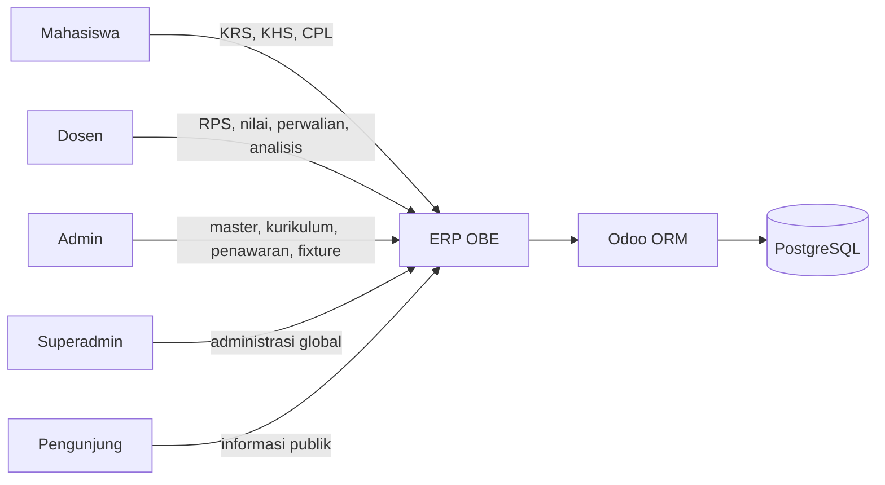

# 5. Business Architecture

## 5.1 Capability Map

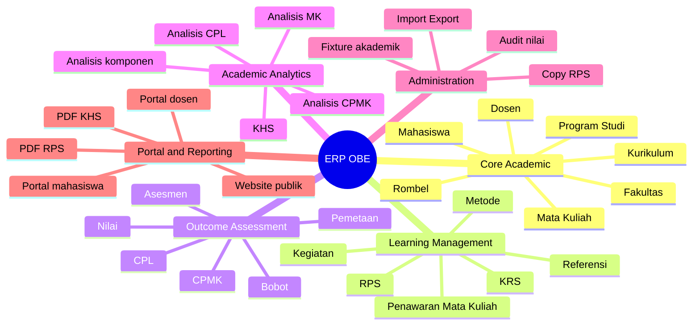

## 5.2 Proses Bisnis Utama

### Master Data dan Kurikulum

Admin mengelola fakultas, prodi, kurikulum, mata kuliah, dosen, mahasiswa, rombel, dan tahun ajaran. Unique constraint menjaga kode prodi/mata kuliah/CPL/CPMK. Mata kuliah dibatasi pada prodi, rombel, kurikulum, dosen, dan prasyarat yang sama prodi.

### CPL dan CPMK

CPL dimiliki prodi. CPMK dimiliki mata kuliah. CPL-CPMK dipetakan melalui `erpobe.akademik.cpl.mk.cpmk`, sedangkan MK-CPL dipetakan melalui `erpobe.akademik.mk.cpl`. Kedua mapping mempunyai constraint prodi yang sama.

### Penawaran dan RPS

Admin membuat penawaran untuk tahun ajaran, prodi, dan rombel. RPS dibuat atau disalin untuk penawaran line. RPS melewati draft → review → final. RPS final tidak dapat diedit atau dihapus; revisi dibuat sebagai versi baru.

### KRS

Mahasiswa memilih mata kuliah dari penawaran aktif yang sesuai rombel dan prodi. KRS melewati draft, submitted, approved/rejected. Total SKS dibatasi 24 secara default. Dosen wali memvalidasi KRS milik mahasiswa bimbingan.

### Input Nilai

Portal dosen hanya menerima input untuk kelas yang menjadi koordinasi/tim pengampu dosen. Input memerlukan RPS final dan bobot lengkap. Nilai komponen dibatasi 0–100, bertipe actual/simulated/legacy, dan memiliki audit perubahan.

### Capaian dan Pelaporan

Grade CPMK dihitung dari bobot komponen terhadap CPMK. Grade MK dihitung dari bobot CPMK terhadap MK. Grade CPL dihitung lintas mata kuliah dari grade CPMK dan bobot CPMK pada RPS. Hasil disinkronkan ke KHS.

## 5.3 Business Process Diagrams

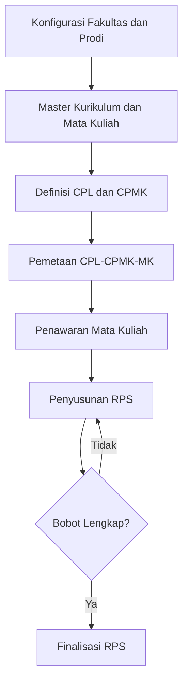

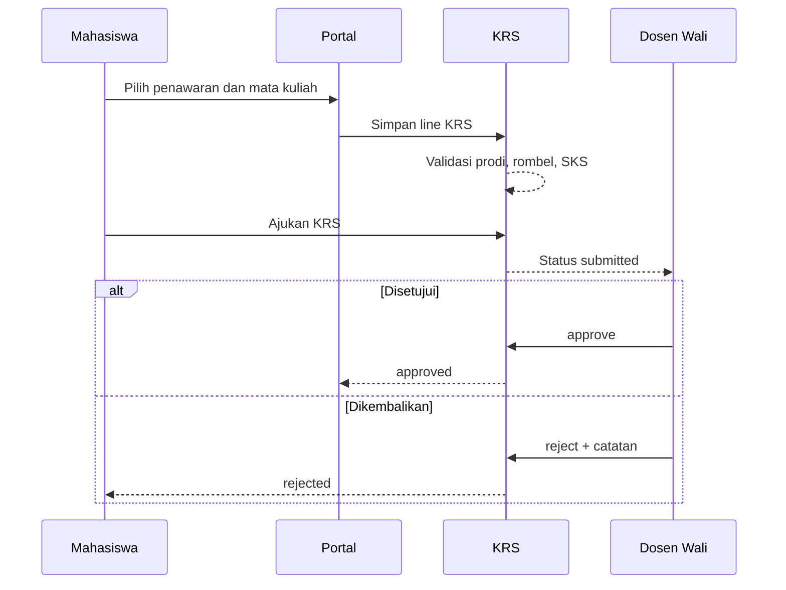

# 6. Application Architecture

## 6.1 Komponen Aplikasi

| Component | Business Function | Technical Implementation | Dependencies | User | Status |
|---|---|---|---|---|---|
| Master Akademik | Data fakultas, prodi, dosen, mahasiswa, rombel, MK | Model dan XML view | Odoo base, contacts | Admin/Superadmin | Implemented |
| Kurikulum/OBE | CPL, CPMK, mapping | ORM model dan constraint | Master MK/Prodi | Admin | Implemented |
| RPS | Struktur RPS, snapshot, bobot, aktivitas | Python model, mixin lock, QWeb PDF | CPL/CPMK/Komponen | Admin/Dosen | Implemented |
| Penawaran/KRS | Penawaran kelas dan KRS | One2many/M2M, workflow state | Tahun ajaran, rombel, MK | Admin/Mahasiswa/Dosen wali | Implemented |
| Grading | Nilai komponen dan hasil | Computed fields, overrides, audit | RPS, KRS, OBE mapping | Dosen/Admin | Implemented |
| Analitik | Pivot/graph MK/CPMK/CPL/komponen | PostgreSQL SQL view + Odoo view | Grade models | Admin/Dosen/Mahasiswa | Implemented |
| KHS | KHS/transkrip dan PDF | Aggregate/sync model, QWeb | Grade MK/CPMK/CPL/component | Admin/Mahasiswa | Implemented |
| Portal | Workflow website | HTTP controllers dan QWeb | portal, website | Dosen/Mahasiswa | Implemented |
| Import/Ekspor | Pemindahan master data | Transient wizard, openpyxl/xlsxwriter | CSV/XLSX | Admin/Superadmin | Implemented |

## 6.2 Application Interaction

Alur aktual adalah: Browser → route/controller atau backend action → Odoo ORM → model method/computed field → PostgreSQL → report/view/portal. Untuk input nilai portal, form mengirim nilai komponen, model membuat atau memperbarui grade, method `_trigger_academic_recompute()` menghitung CPMK/MK/CPL, lalu KHS disinkronkan.

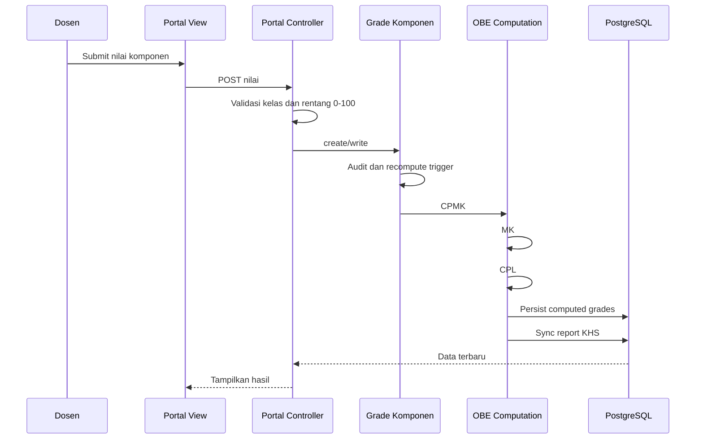

# 7. Data Architecture

## 7.1 Conceptual and Logical Model

Entitas utama:

- Fakultas, Prodi, Kurikulum, Rombel, Angkatan
- Dosen, Mahasiswa
- Mata Kuliah, CPL, CPMK
- Penawaran dan Penawaran Line
- RPS dan komponen snapshot
- KRS dan KRS Line
- Grade Komponen, Grade MK, Grade CPMK, Grade CPL
- KHS dan line KHS
- Analitik SQL View

Relasi aktual:

- Fakultas 1—N Prodi; Prodi 1—N Mata Kuliah/CPL/CPMK/Rombel/Mahasiswa.
- Mata Kuliah 1—N CPMK.
- CPL M—N CPMK melalui bridge `erpobe.akademik.cpl.mk.cpmk`.
- Mata Kuliah M—N CPL melalui `erpobe.akademik.mk.cpl`.
- RPS memiliki snapshot komponen, bobot CPMK→MK, dan bobot komponen→CPMK.
- KRS 1—N KRS Line; KRS Line mengacu penawaran line.
- Grade Komponen mengacu KRS Line dan snapshot RPS.
- Grade CPMK/MK mengacu mahasiswa, CPMK/MK, KRS Line, dan RPS.
- Grade CPL mengacu mahasiswa dan CPL.

## 7.2 Physical Model

Odoo ORM membuat tabel PostgreSQL dengan nama titik diganti garis bawah, misalnya `erpobe_grade_cpmk`, kecuali `_auto=False` untuk virtual/SQL view. `grade_cpl_rombel`, `grade_cpl_angkatan`, `cpmk_rombel`, `cpmk_angkatan`, `grade_mk_rombel`, `grade_mk_angkatan`, dan empat model summary merupakan model `_auto=False` yang membuat atau memanfaatkan view pada `init()`.

Master dosen dan mahasiswa memakai `_inherits={"res.partner":"partner_id"}`, sehingga sebagian identitas disimpan melalui delegasi ke `res.partner`. Odoo juga menyediakan Odoo core `res.users` sebagai akun login.

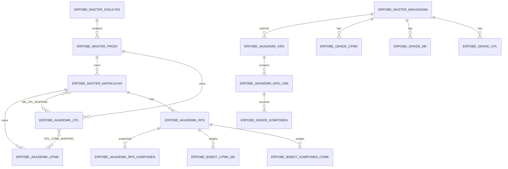

## 7.3 Data Dictionary Penting

| Model | Field | Type | Required | Relation | Description | Computation |
|---|---|---|---|---|---|---|
| `erpobe.grade.komponen` | `nilai` | Float | Default 0 | - | Nilai asesmen 0–100 | User input |
| `erpobe.grade.komponen` | `is_graded` | Boolean | - | - | Menentukan nilai dianggap dinilai | User/input logic |
| `erpobe.grade.komponen` | `origin` | Selection | Yes | - | actual, simulated, legacy | User/source |
| `erpobe.bobot.komponen.cpmk` | `bobot_komponen_cpmk` | Float | Yes | RPS, CPMK, snapshot | Bobot komponen terhadap CPMK | Validation 100 |
| `erpobe.bobot.cpmk.mk` | `bobot_cpmk_mk` | Float | - | RPS, CPMK | Bobot CPMK terhadap MK | Validation 100 |
| `erpobe.akademik.rps.komponen` | `bobot` | Float | - | RPS, komponen | Bobot komponen terhadap MK | Validation 100 |
| `erpobe.grade.cpmk` | `nilai_cpmk` | Float computed | - | mahasiswa, CPMK, RPS, KRS line | Capaian CPMK | Stored |
| `erpobe.grade.cpmk` | `is_available` | Boolean computed | - | - | Ada penyebut bobot | Stored |
| `erpobe.grade.mk` | `nilai_mk` | Float computed | - | mahasiswa, MK, RPS, KRS line | Nilai akhir MK | Stored |
| `erpobe.grade.cpl` | `nilai_cpl` | Float computed | - | mahasiswa, CPL | Agregat lintas MK/CPMK | Stored |

## 7.4 Integrity and Lifecycle

- Required field, SQL constraint, ORM constraint, dan unique constraint digunakan.
- Nilai komponen dibatasi 0–100.
- CPMK/MK/CPL dinyatakan available hanya pada kondisi data yang ditentukan method.
- Riwayat audit bersifat immutable: write/unlink ditolak.
- RPS final read-only dan tidak dapat dihapus.
- Audit archival/deletion tidak teridentifikasi.

## 7.5 Data Flow

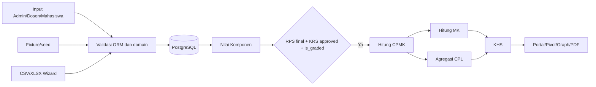

# 8. OBE Computation Architecture

## 8.1 Mapping Architecture

CPL dipetakan ke CPMK. CPMK melekat pada mata kuliah. RPS mengambil semua CPMK mata kuliah melalui `_compute_cpmk_ids`. RPS terkait CPL dihitung dari mapping CPMK. MK-CPL digunakan sebagai filter kedua pada perhitungan CPL.

## 8.2 Formula CPMK

Untuk satu `grade_cpmk`:

$$
a_{i}=b_{komponen,i}\times b_{komponen\rightarrow CPMK,i}/100
$$

$$
NilaiCPMK=\frac{\sum_i NilaiKomponen_i\times a_i}{\sum_i a_i}
$$

Implementasi:

- Input: nilai komponen, snapshot bobot komponen, alokasi komponen-CPMK.
- Hanya grade dengan `is_graded=True`, RPS `final`, dan KRS `approved`.
- Record dengan grade/tidak tersedia tidak menambah penyebut.
- `is_available=True` hanya jika penyebut bobot `denominator > 0`.
- Status: `belum_tersedia`, `tercapai`, `belum`.
- Target CPMK dari `cpmk_id.target_nilai`, default 70.

## 8.3 Formula MK

$$
NilaiMK=\frac{\sum_j NilaiCPMK_j\times b_{CPMK\rightarrow MK,j}/100}{\sum_j b_{CPMK\rightarrow MK,j}/100}
$$

Hanya grade CPMK `is_available=True` yang dipakai. Jika tidak ada bobot positif, MK unavailable. Bobot total tidak dinormalisasi ulang secara implisit: penyebut adalah bobot grade CPMK yang tersedia, tetapi bobot MK keseluruhan divalidasi 100% sebelum RPS final.

## 8.4 Formula CPL

$$
NilaiCPL=\frac{\sum_k NilaiCPMK_k\times b_{CPMK\rightarrow MK,k}}{\sum_k b_{CPMK\rightarrow MK,k}}
$$

Nilai dibatasi 0–100. Implementasi:

- Mengambil mapping CPL–CPMK.
- Memastikan CPMK berasal dari prodi yang sama dan MK CPMK termasuk mapping MK-CPL CPL bersangkutan.
- Mengambil grade CPMK terbaik untuk mahasiswa/CPMK lintas attempt.
- Bobot berasal dari RPS grade CPMK yang dipilih.
- CPL hanya available jika ada bobot penyebut positif.
- Status `belum_tersedia`, `dalam_proses`, `tercapai`, atau `belum`.

## 8.5 Edge Cases

- Nilai kosong belum dinilai tidak ditambahkan ke penyebut CPMK.
- Komponen yang tidak aktif dan alokasi yang belum memiliki snapshot tidak dihitung.
- Bobot 0 tidak dihitung.
- Pembagian nol menghasilkan 0 dan `is_available=False`.
- Legacy grade dengan tidak ada RPS/KRS line mendapat nilai 0 dan unavailable.
- CPL memilih grade CPMK tertinggi untuk kombinasi mahasiswa–CPMK, dengan tie-break berdasarkan RPS/KRS/grade id.
- Nilai simulasi tidak dianggap actual pada kelengkapan portal dosen, tetapi tetap dapat memicu komputasi sebelum diganti actual.
- Bobot total diverifikasi tepat 100% dengan toleransi 0,01.

## 8.6 RPS and Assessment

RPS memiliki metadata MK, versi, status, tahun, bobot, CPMK, CPL, komponen, kegiatan perkuliahan, metode, referensi, dan rubrik. Komponen RPS adalah snapshot master komponen. Bobot memiliki tiga lapisan: komponen terhadap MK, komponen terhadap CPMK, dan CPMK terhadap MK.

Asesmen menggunakan komponen penilaian dengan rentang 0–100. Portal dosen dapat menilai hanya komponen pada RPS final. Audit mencatat old/new value, user, alasan, dan bersifat read-only/undeletable.

## 8.7 Computation Flow

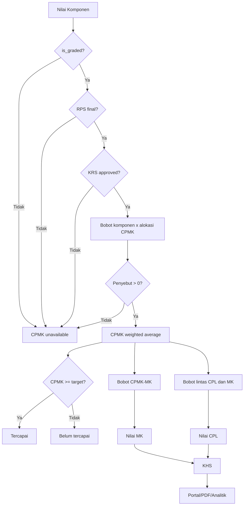

# 9. Technology Architecture

## 9.1 Technology Stack

| Layer | Technology | Version | Purpose | Evidence |
|---|---|---|---|---|
| Application | Odoo | 19 | ERP framework | Manifest/ode source path |
| Language | Python | 3.12.3 | Model/controller/wizard | Runtime environment |
| Database | PostgreSQL | Belum teridentifikasi | Persistensi ORM dan SQL view | Model `_table`, SQL init |
| OS | Ubuntu 24.04 | Belum teridentifikasi build | Runtime konteks | Project context |
| Virtualization | WSL2 | Belum teridentifikasi | Development runtime | Project context |
| Python env | venv | Belum teridentifikasi | Dependency isolation | `/venv` |
| ORM | Odoo ORM | Odoo 19 | Model, constraint, compute | `models/*.py` |
| UI | QWeb, XML, SCSS, JS | Odoo 19 | Backend and portal | `views`, `static` |
| Report | QWeb PDF | Odoo 19 | KHS/RPS | `triton_reports.xml` |
| Spreadsheet | openpyxl, xlsxwriter | Belum teridentifikasi | Import/ekspor | Manifest |
| Chart | Chart.js | Versi dikendalikan Odoo asset | Dashboard/visualisasi | `web.chartjs_lib` |

## 9.2 Runtime Architecture

Browser mengakses Odoo HTTP/Web. Odoo memuat addon melalui addons path, mengolah controller dan view, lalu ORM berkomunikasi ke PostgreSQL. Aset frontend dimuat sebagai `web.assets_frontend`; asset backend dimuat sebagai `web.assets_backend` dan backend lazy.

## 9.3 Deployment

Tidak ada bukti Docker, Kubernetes, reverse proxy, cloud provider, konfigurasi production database, backup, atau CI/CD runtime dalam workspace. `.github/workflows/deploy.yml` adalah bukti keberadaan deployment workflow, tetapi rincian infrastruktur target memerlukan Needs Verification.

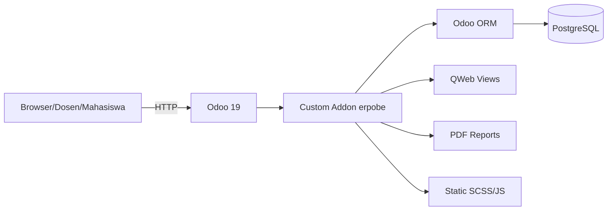

# 10. Security Architecture

## 10.1 Role and Permission

Empat grup ditemukan:

- Mahasiswa: grup portal yang dapat membuat/melihat KRS miliknya dan membaca sejumlah data akademik.
- Dosen: grup portal yang dapat melihat RPS/kelas dan mengelola nilai sesuai method.
- Admin: grup user internal dengan ACL luas.
- Superadmin: mewarisi Admin dan menerima global record rule.

Role tambahan tidak disimpulkan. Superadmin/`base.group_system` merupakan grup Odoo bawaan yang digunakan sebagai boundary global, bukan custom role baru.

| Area | Mahasiswa | Dosen | Admin | Superadmin |
|---|---|---|---|---|
| Fakultas/Prodi | Read in scope | Read in scope | CRUD in scope | CRUD global |
| Mahasiswa | Own record Read/Write | Read in scope | CRUD in scope | Global |
| Mata Kuliah | Read in scope | Read/Write Dosen ACL | CRUD | Global |
| CPL/CPMK/Mapping | Read in scope | CRUD | CRUD | Global |
| RPS | Read | Read/Write, Final finalisasi terbatas | CRUD | Global |
| KRS | Own create/read/write flow | Read/Advisor action | CRUD | Global |
| Nilai komponen | No ACL | CRUD | CRUD | Global |
| Grade CPL/MK/CPMK | Read | Mostly read/CRUD | CRUD | Global |
| KHS | Read own | No KHS ACL | CRUD | Global |
| Wizard import | No ACL | No ACL | CRUD | CRUD |

## 10.2 Security Mechanisms

- Autentikasi: Odoo `auth='user'` pada portal dosen/mahasiswa.
- Authorization: ACL pada model dan record rules pada recordset.
- UI: menu groups membatasi menu.
- Controller: `_require_student`, `_require_teacher`, `_authorized_teacher_line`, dan `_check_student_owner`.
- Public route: `auth='public'` dan data diambil menggunakan `sudo()` untuk konten publik. Tidak boleh disimpulkan sebagai akses ke seluruh data akademik.
- Delegation: `sudo()` digunakan untuk sinkronisasi laporan dan beberapa data publik; temuan ini memerlukan review pada setiap controller.

## 10.3 Gap Analysis

- Record rule prodi dan mahasiswa sendiri tersedia, tetapi cakupan seluruh model perlu review konsisten.
- Beberapa controller melakukan `sudo()` dan menerapkan otorisasi manual; kerentanan tidak dapat dinyatakan tanpa pengujian runtime.
- Public profile route dapat menampilkan dosen/mahasiswa berdasarkan ID; implementasi harus memastikan hanya field safe yang ditampilkan.
- Password/credential tidak ditampilkan atau disimpan pada dokumentasi ini.

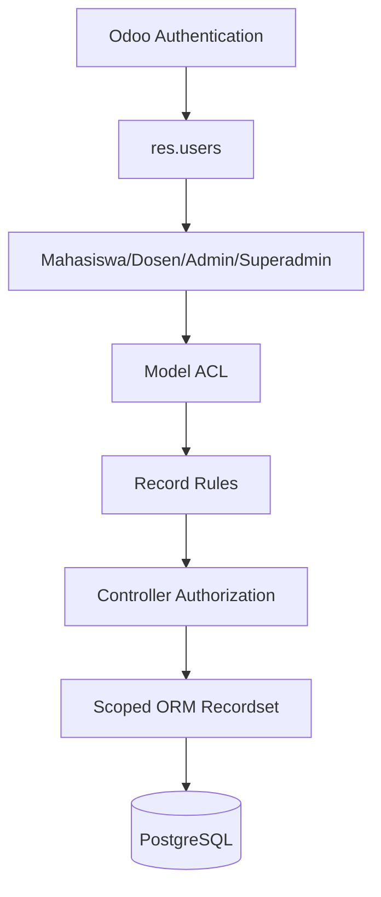

# 11. Integration Architecture

| Integration | Source | Target | Protocol | Data | Authentication | Status |
|---|---|---|---|---|---|---|
| Odoo internal | Custom addon | Odoo core | Python/ORM | res.users, res.partner, mail | Odoo session/ACL | Implemented |
| HTTP portal | Browser | Odoo controller | HTTP/JSON rendered QWeb | Academic/profile/KRS/grades | Session/public | Implemented |
| Spreadsheet import/export | Wizard | PostgreSQL | CSV/XLSX | Master academic data | Odoo role ACL | Implemented |
| PDF report | Odoo report engine | Browser | QWeb PDF | KHS/RPS | Odoo report ACL | Implemented |
| External API | - | - | - | - | - | Not Implemented |
| Cron/Scheduled action | - | - | - | - | - | Not Implemented |
| Email external | Odoo mail | - | - | - | - | Dependency tersedia, use case khusus Belum teridentifikasi |

Tidak ditemukan API eksternal nyata, scheduled action addon, atau integrasi pembayaran/SIAKAD eksternal. Website dan portal merupakan integrasi internal Odoo.

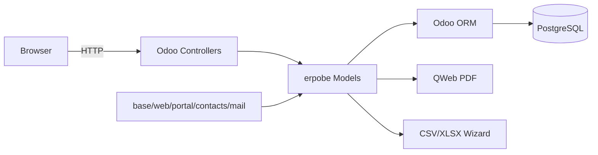

# 12. Reporting and Analytics Architecture

## 12.1 Inventory

| Laporan/Analitik | Sumber | Aggregation | Output | Access |
|---|---|---|---|---|
| KHS | Grade MK/CPMK/CPL/component | IPK, SKS lulus, line nilai | QWeb/PDF dan portal | Admin/Mahasiswa |
| RPS PDF | RPS | Struktur dan bobot | QWeb/PDF | Admin/Dosen/Mahasiswa sesuai route |
| Summary MK | `erpobe.summary.mk` SQL view | Average nilai available | List/Pivot/Graph | Admin/Dosen/Mahasiswa read ACL |
| Summary CPMK | `erpobe.summary.cpmk` SQL view | Average grade available | List/Pivot/Graph | Admin/Dosen/Mahasiswa |
| Summary CPL | `erpobe.summary.cpl` SQL view | Average grade available | List/Pivot/Graph | Admin/Dosen/Mahasiswa |
| Summary komponen | `erpobe.summary.komponen` SQL view | Average nilai komponen | List/Pivot/Graph | Admin/Dosen/Mahasiswa |
| Bobot monitor | RPS weight validation | Kelompok bobot dan isu | Form/list/export | Admin/Superadmin |
| Portal dosen | KRS, grade, summary | Kelas/CPMK/CPL | Web | Dosen |
| Portal mahasiswa | KHS, CPL, courses | Nilai pribadi | Web | Mahasiswa |

Fixture akademik dapat membentuk data simulasi/dummy. Hasil analitik harus dibedakan apakah berasal dari nilai actual, nilai simulated, atau sumber fixture. Source code menyimpan asal fixture pada `erpobe.akademik.fixture.source` dan nilai pada `grade.komponen.origin`.

# 13. User Workflow and User Journey

## 13.1 Admin

1. Login.
2. Kelola fakultas dan prodi.
3. Kelola dosen, mahasiswa, rombel, mata kuliah, tahun ajaran.
4. Kelola CPL/CPMK/mapping.
5. Buat penawaran dan RPS.
6. Finalisasi RPS setelah bobot lengkap.
7. Jalankan import/ekspor bila diperlukan.
8. Lihat laporan dan analisis.

## 13.2 Dosen

1. Login ke portal.
2. Lihat kelas yang diampu sebagai koordinator/tim pengampu.
3. Buat/revisi/copy RPS.
4. Pastikan bobot lengkap dan finalisasi.
5. Input nilai aktual komponen.
6. Lihat hasil MK/CPMK dan analisis CPL.
7. Proses KRS mahasiswa bimbingan.

## 13.3 Mahasiswa

1. Login ke portal.
2. Pilih penawaran aktif sesuai rombel dan prodi.
3. Buat/edit/diajukan KRS.
4. Tunggu persetujuan dosen wali.
5. Lihat mata kuliah dan RPS yang relevan.
6. Lihat KHS/nilai komponen dan capaian CPL.

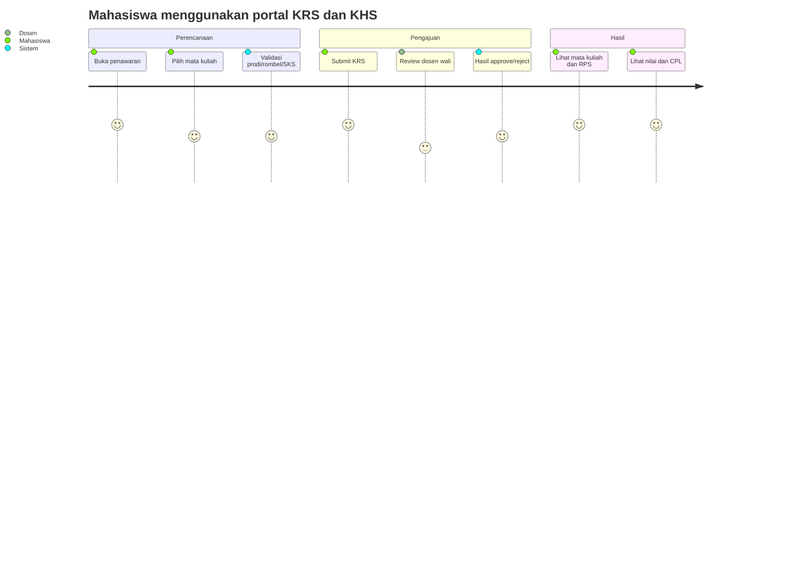

# 14. Architecture Diagrams

## 14.1 Enterprise Context

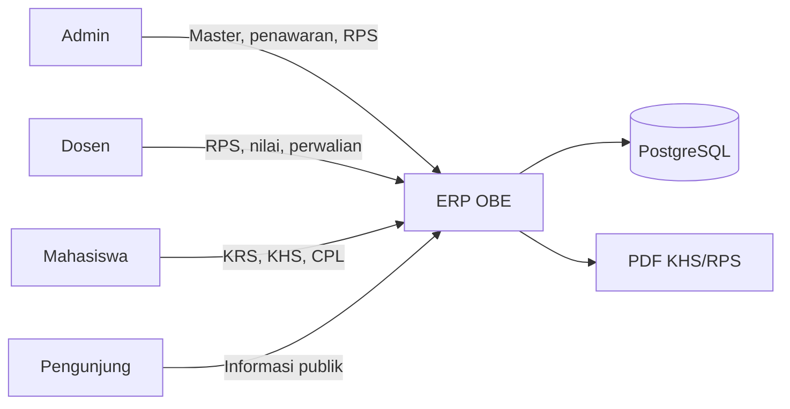

## 14.2 Application Component

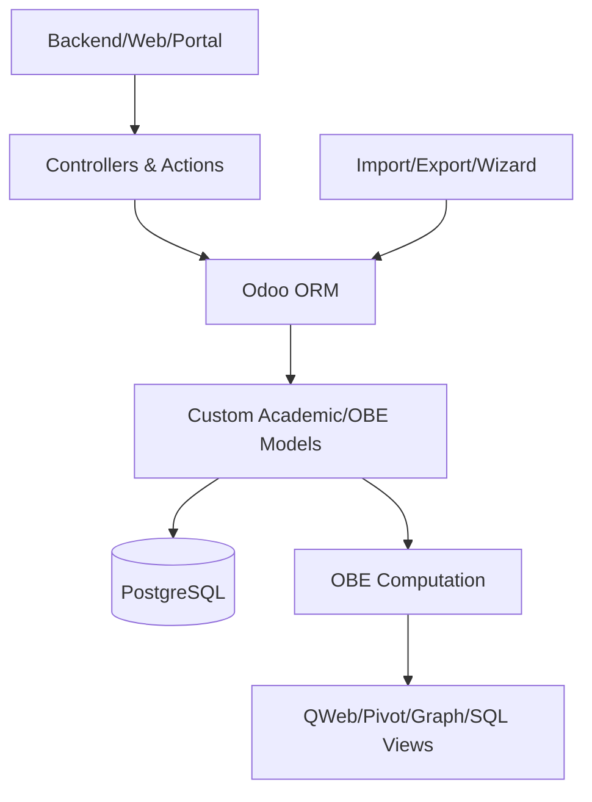

## 14.3 Conceptual Data

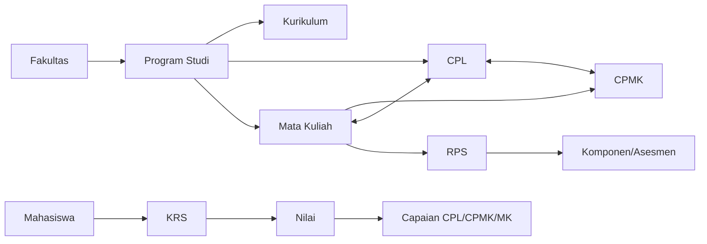

## 14.4 Logical Data

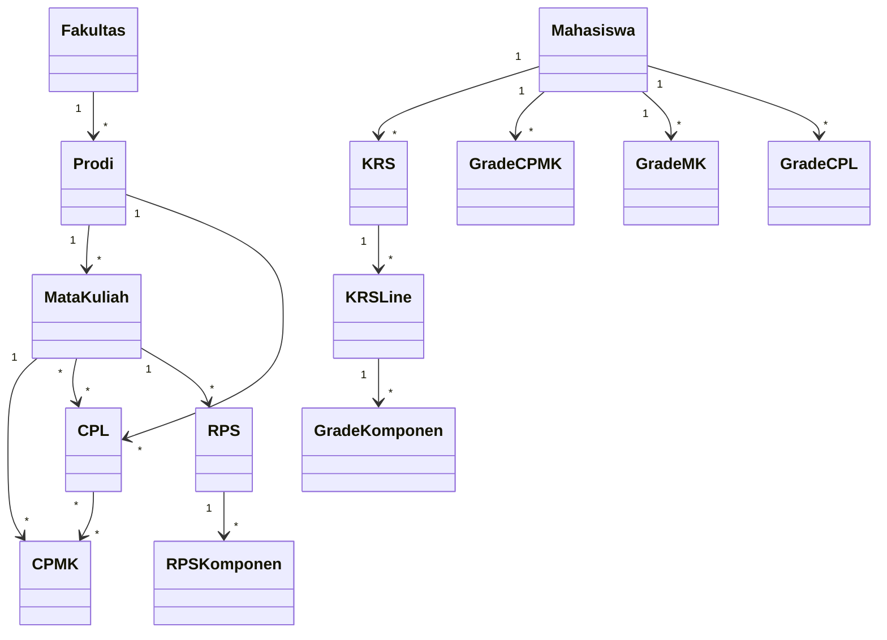

## 14.5 Security and Deployment

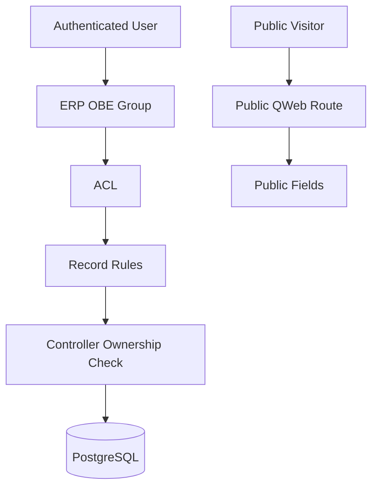

## 14.6 Integration

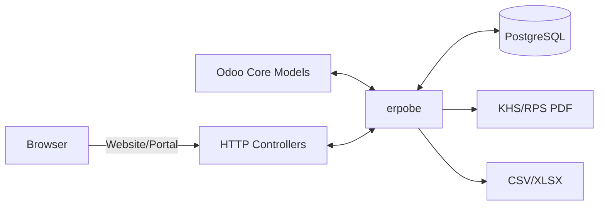

# 15. Architecture Gap Analysis

| ID | Domain | Current State | Expected State | Identified Gap | Impact | Priority | Recommendation |
|---|---|---|---|---|---|---|---|
| G1 | OBE computation | Implemented | Bobot dan lineage lengkap | Edge lineage legacy tetap unavailable | Data lama mungkin tidak dihitung | High | Migrasi legacy ke RPS/KRS line yang eksplisit |
| G2 | RPS | Implemented | Bobot tepat 100% final | Bobot draft dapat kurang, review UI tetap perlu | Finalisasi diblokir sesuai implementasi | Medium | Pertahankan validasi dan tambahkan indikator per user |
| G3 | Security | Implemented | Isolation konsisten | Cakupan model dan sudo perlu audit komprehensif | Risiko leakage bila route/method salah | High | Test akses lintas prodi dan lintas mahasiswa |
| G4 | Public portal | Implemented | Publik hanya data aman | Public routes memakai sudo/manual filtering | Risk misinformation/direct exposure | High | Centralize public field allowlist |
| G5 | Integration | Implemented internal only | Sistem akademik terintegrasi jika dibutuhkan | Tidak ada external API/SIAKAD ditemukan | Sinkronisasi manual | Medium | Tambahkan API adapter hanya setelah kebutuhan terverifikasi |
| G6 | Scheduled automation | Not Implemented | Sinkronisasi berkala bila perlu | Tidak ada cron/base automation | Proses tetap manual/action-driven | Medium | Evaluasi kebutuhan cron sebelum implementasi |
| G7 | Deployment | Needs Verification | Production configuration terdokumentasi | Tidak ada bukti deploy/backup/HA | Operasional tidak terdokumentasi | High | Dokumen deployment dan backup |
| G8 | Testing | Implemented | Regression coverage luas | Tidak ada bukti hasil eksekusi di workspace | Status suite Needs Verification | Medium | Jalankan test dengan environment Odoo |
| G9 | Reporting | Implemented | Data simulation actual explicitly labeled | Simulasi dapat terbaca sebagai nilai aktual | Misinformasi | High | UI badge actual/simulated dan audit source |
| G10 | Data lifecycle | Partially Implemented | Retensi/archive policy | Tidak ada kebijakan archival/deletion | Pertumbuhan DB dan kepatuhan | Medium | Tambahkan retention policy dan archive trial |

# 16. Target Architecture and Roadmap

## Short-Term

| ID | Problem | Current | Target | Risk | Priority | Acceptance Criteria |
|---|---|---|---|---|---|---|
| ST1 | Security audit | ACL/rules ada | Semua model dan route teruji lintas role | Akses berlebih | Critical | Test role matrix lulus lintas prodi/own data |
| ST2 | Simulated data | Origin tersedia | UI and report label origin | Salah tafsir data | High | Semua nilai simulasi diberi label |
| ST3 | Legacy computation | Legacy unavailable | Migrasi lineage bila lengkap | Kehilangan riwayat | High | Record lama mendapat RPS/KRS lineage atau status documented |
| ST4 | Audit result | No test execution evidence | Test suite dijalankan | Regression | High | Test list/rps/weight/import/security lulus |

## Mid-Term

- Normalisasi endpoint analytics berdasarkan snapshot attempt.
- Tambahkan report capaian dengan source dan data availability.
- Sediakan dashboard institusi berbasis virtual SQL views.
- Tambahkan notifikasi workflow KRS/RPS bila diperlukan.
- Dokumentasikan backup, restore, upgrade, dan migration procedure.

## Long-Term

- Analisis pembelajaran lanjutan lintas angkatan dan prodi.
- API integration terstandardisasi untuk sistem akademik lain bila ada kebutuhan.
- Performance indexing and aggregation optimization untuk volume besar.
- Governance data dan definisi MPL/target capaian yang terdokumentasi.

# 17. Risk and Technical Considerations

| Risk ID | Category | Description | Root Cause | Likelihood | Impact | Level | Mitigation | Component |
|---|---|---|---|---|---|---|---|---|
| R1 | OBE | CPL grade lintas attempt memilih tertinggi | Selection logic | Medium | Medium | High | Dokumentasikan dan berikan policy attempt | Grade CPL |
| R2 | Data | Legacy grade unavailable | Tidak ada RPS/KRS lineage | Medium | High | High | Migrasi lineage atau status historical | Grade |
| R3 | Security | Controller exposure via sudo | Public/sync controller | Medium | High | High | Safe fields and controller tests | Controllers |
| R4 | Security | Record rules incomplete | Not every model rule visible | Medium | High | High | Model-rule inventory and negative tests | Security |
| R5 | Computation | Bobot partial may be misleading | Draft values and denominator | Medium | Medium | High | UI badges and finalization lock | RPS/Weights |
| R6 | Data | Simulated grades can affect reports | Simulation method | Medium | High | High | Label and filtering | Grade Komponen |
| R7 | Operational | No deployment evidence | Environment not configured/repository | Medium | High | High | Deployment runbook | Infrastructure |
| R8 | Performance | Computed recompute scans records | Multiple search and recompute loops | Medium | Medium | Medium | Add targeted recompute/batch testing | Grade |
| R9 | Maintainability | Large addon with migration/fixture | 56 custom model names, multiple concerns | Medium | Medium | Medium | Module split or domain grouping | Addon |

# 18. Source Code Traceability

| EA Component | Implementation File | Model/Class | Method/Field | Evidence |
|---|---|---|---|---|
| Manifest | `custom_module/erpobe/__manifest__.py` | addon manifest | `depends`, `assets`, `data`, `external_dependencies` | Implemented |
| Group | `security/groups.xml` | `res.groups` | group_mahasiswa/dosen/admin/superadmin | Implemented |
| ACL | `security/ir.model.access.csv` | model ACL | perm_read/write/create/unlink | Implemented |
| Record Rules | `security/rules.xml` | `ir.rule` | prodi, mahasiswa own, global superadmin | Implemented |
| Faculty/Prodi | `models/akademik_fakultas.py`, `models/master_prodi.py` | `erpobe.master.fakultas`, `erpobe.master.prodi` | relations/constraints | Implemented |
| Course | `models/master_akademik.py` | `ErpObeMasterMataKuliah` | `_check_related_faculties`, CPMK, RPS, CPL | Implemented |
| CPL | `models/akademik_cpl.py` | `erpobe.akademik.cpl` | target_nilai, cpmk/mk mappings | Implemented |
| CPMK | `models/akademik_cpmk.py` | `erpobe.akademik.cpmk` | mk_id, target_nilai, cpl_mapping_ids | Implemented |
| CPL-CPMK mapping | `models/akademik_cpl_mk_cpmk.py` | `erpobe.akademik.cpl.mk.cpmk` | unique mapping and prodi constraint | Implemented |
| MK-CPL mapping | `models/akademik_cpl_mk_cpmk.py` | `erpobe.akademik.mk.cpl` | unique mapping and prodi constraint | Implemented |
| RPS | `models/akademik_rps.py` | `erpobe.akademik.rps` | status, cpmk_ids, bobot_ids, action_finalize | Implemented |
| RPS Lock | `models/rps_lock.py` | `erpobe.rps.lock.mixin` | write/unlink/final immutability | Implemented |
| Component snapshot | `models/rps_komponen.py` | `erpobe.akademik.rps.komponen` | bobot, aktif, allocation_ids | Implemented |
| Weight CPMK-MK | `models/bobot_cpmk_mk.py` | `erpobe.bobot.cpmk.mk` | bobot_cpmk_mk, `_compute_total_bobot` | Implemented |
| Weight component-CPMK | `models/bobot_komponen_cpmk.py` | `erpobe.bobot.komponen.cpmk` | bobot_komponen_cpmk, validitas | Implemented |
| Weight validation | `models/weight_validation.py` | `erpobe.weight.validation` | target 100, tolerance 0.01, `validate_rps` | Implemented |
| KRS | `models/akademik_krs.py` | `erpobe.akademik.krs` | submit/approve/reject, max 24 SKS | Implemented |
| Penawaran | `models/akademik_penawaran.py` | `erpobe.akademik.penawaran` | rombel, line, RPS status | Implemented |
| Grade component | `models/grade.py` | `erpobe.grade.komponen` | nilai, origin, is_graded, audit | Implemented |
| Grade CPMK | `models/grade_cpmk.py` | `erpobe.grade.cpmk` | `_compute_nilai_cpmk`, status | Implemented |
| Grade MK | `models/grade_mk.py` | `erpobe.grade.mk` | `_compute_nilai_mk` | Implemented |
| Grade CPL | `models/grade_cpl.py` | `erpobe.grade.cpl` | `_compute_nilai_cpl`, status | Implemented |
| KHS | `models/report_khs.py` | `erpobe.report.khs` | action_generate, sync, statistic | Implemented |
| SQL analytics | `models/report_summary.py` | `erpobe.summary.*` | `_auto=False`, `init()` SQL view | Implemented |
| Teacher portal | `controllers/portal_dosen.py` | `TritonPortalDosen` | grades, RPS, analysis, perwalian | Implemented |
| Student portal | `controllers/portal_mahasiswa.py` | `TritonPortalMahasiswa` | KRS, KHS, CPL, RPS | Implemented |
| Public portal | `controllers/*.py` | Public controllers | public routes and safe list helper | Implemented |
| PDF | `views/triton_reports.xml` | `ir.actions.report` | `triton_report_khs`, `triton_report_rps` | Implemented |
| Import/export | `wizard/import_export_mixin.py` | `erpobe.import.export.mixin` | CSV/XLSX validate/export | Implemented |
| Test | `tests/*.py` | Odoo test suite | weight, RPS, import, UI, workflow | Implemented source; runtime result Needs Verification |

# 19. Kesimpulan

Project memiliki implementasi enterprise OBE yang substansial pada addon `erpobe`. Kunci arsitektur adalah pemisahan master, mapping, RPS snapshot, nilai komponen, computed grade, KHS, dan portal. Rantai OBE dapat ditelusuri langsung ke source code. Implementasi yang belum ditemukan secara nyata tidak ditambahkan sebagai aktual.

Fokus pengembangan pertama adalah keamanan lintas role/prodi, penanganan origin nilai, migrasi lineage legacy, pengujian runtime, dan dokumentasi operasi. Target architecture harus mempertahankan Odoo/PostgreSQL sebagai platform utama kecuali terdapat bukti kebutuhan integrasi atau skalabilitas yang mengharuskan perubahan.

# 20. Glossary

- **ACL:** Access Control List model Odoo.
- **CPL:** Capaian Pembelajaran Lulusan.
- **CPMK:** Capaian Pembelajaran Mata Kuliah.
- **KRS:** Kartu Rencana Studi.
- **KHS:** Kartu Hasil Studi.
- **OBE:** Outcome-Based Education.
- **RPS:** Rencana Pembelajaran Semester.
- **Rombel:** Rombongan belajar.
- **Record Rule:** Aturan record-level Odoo.
- **Snapshot:** Salinan komponen RPS untuk stabilitas penilaian lintas versi.
- **TOGAF ADM:** Kerangka konseptual arsitektur enterprise.

# 21. Appendix

## A. Custom Model Inventory

Model `_name` terverifikasi mencakup sekitar 56 identitas model custom dan abstract/mixin/report, termasuk:

- `erpobe.master.fakultas`, `.prodi`, `.dosen`, `.mahasiswa`, `.matakuliah`, `.rombel`
- `erpobe.akademik.kurikulum`, `.cpl`, `.cpmk`, `.komponen`, `.tahunajaran`, `.penawaran`, `.krs`, `.rps`
- `erpobe.akademik.rps.komponen`, `.kegiatan.perkuliahan`, `.metode.pembelajaran`, `.referensi`, `.rubrik.penilaian`, `.kriteria`
- `erpobe.bobot.cpmk.mk`, `erpobe.bobot.komponen.cpmk`
- `erpobe.input.nilai`, `erpobe.grade.komponen`, `.audit`, `.mk`, `.cpmk`, `.cpl`
- `erpobe.report.khs` beserta line MK/CPMK/CPL/komponen
- `erpobe.summary.mk/cpmk/cpl/komponen`
- `erpobe.weight.validation`, `erpobe.weight.monitor`, serta line monitor
- import/export transient wizard dan RPS copy wizard

Daftar lengkap dapat ditelusuri dari `models/__init__.py` dan file pada direktori `models/`. Jumlah tepat model/mixin tidak dijadikan angka total tunggal jika ada inherited model dan virtual model karena definisi nama dan `_auto` perlu konteks.

## B. Verification Status

- Implemented: bukti source code dan konfigurasi tersedia.
- Partially Implemented: model atau UI ada tetapi status keseluruhan memerlukan bukti runtime/lifecycle tambahan.
- Not Implemented: tidak ditemukan pada addon.
- Needs Verification: informasi dari konteks, workflow external, atau environment belum dapat dibuktikan sepenuhnya.
- Proposed: rekomendasi roadmap, bukan kondisi aktual.
